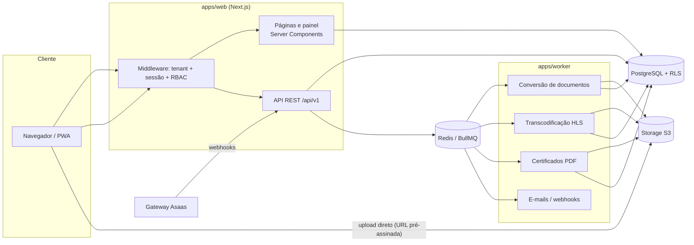
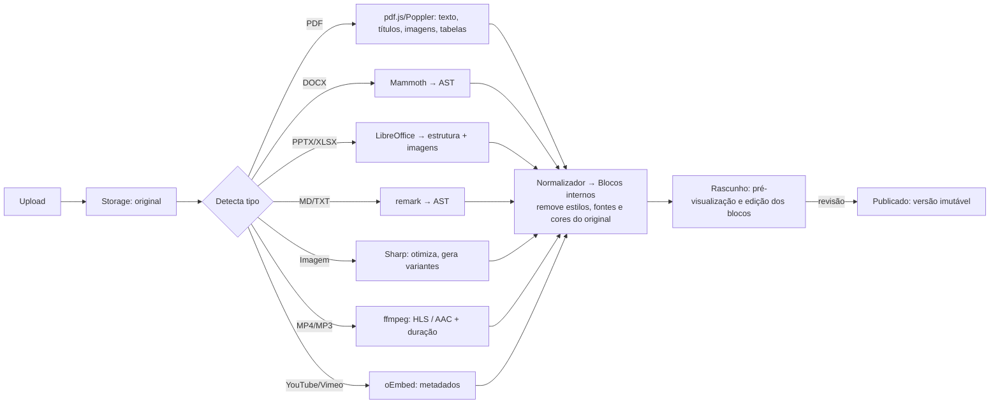
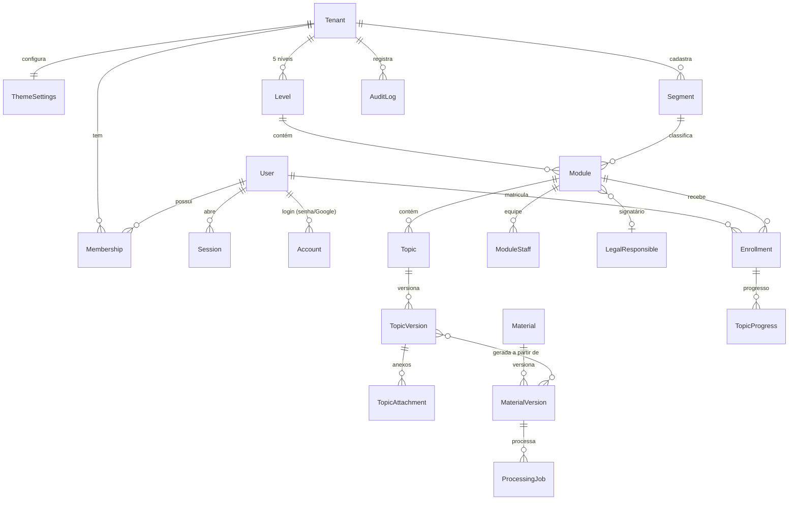

# Plataforma de Capacitação (EAD/LMS) — Proposta de Arquitetura, Modelo de Dados e Design System

> **Status:** proposta para aprovação (pré-Fase 1). Nenhum código de aplicação foi escrito ainda.
> Ao aprovar (ou ajustar) os pontos da seção [12. Decisões para aprovação](#12-decisões-para-aprovação), inicio a Fase 1.

---

## Sumário

1. [Visão geral](#1-visão-geral)
2. [Stack e justificativas](#2-stack-e-justificativas)
3. [Arquitetura de alto nível](#3-arquitetura-de-alto-nível)
4. [Multi-tenant (white-label)](#4-multi-tenant-white-label)
5. [Perfis e permissões (RBAC)](#5-perfis-e-permissões-rbac)
6. [Hierarquia de conteúdo e rotas](#6-hierarquia-de-conteúdo-e-rotas)
7. [Modelo de dados](#7-modelo-de-dados)
8. [Formato interno de conteúdo (blocos) e a regra central de tema](#8-formato-interno-de-conteúdo-blocos-e-a-regra-central-de-tema)
9. [Design system](#9-design-system)
10. [API REST, segurança, LGPD e proteção de conteúdo](#10-api-rest-segurança-lgpd-e-proteção-de-conteúdo)
11. [Plano das fases e escopo detalhado da Fase 1](#11-plano-das-fases-e-escopo-detalhado-da-fase-1)
12. [Decisões para aprovação](#12-decisões-para-aprovação)

---

## 1. Visão geral

Plataforma white-label, multi-segmento, em que um **tenant** (a instituição/dono) cadastra e vende conteúdos de qualquer área, organizados em:

```
Nível (Mentorias | Treinamentos | Cursos | Aulas | Capacitações)
  └── Segmento (Agronegócio, Finanças, Vendas, Arquitetura, …)
        └── Módulo
              └── Assunto/Conteúdo  ← página gerada a partir dos materiais (blocos + questões + fórum + anexos)
```

Princípio que guia toda a arquitetura: **o conteúdo nunca é armazenado como "arquivo para exibir", e sim como blocos estruturados**. A interface só sabe desenhar blocos, e só os desenha com os design tokens. Assim, o critério de aceite global ("subir qualquer arquivo e vê-lo 100% no tema") é garantido por construção, e não por ajuste manual.

---

## 2. Stack e justificativas

| Camada | Escolha | Justificativa |
|---|---|---|
| Web/App | **Next.js 15 (App Router) + TypeScript** | Mantida da sugestão. SSR/ISR para páginas de venda e validação de certificado (SEO), Server Components para o painel, Route Handlers para a API REST. |
| Estilo | **Tailwind CSS v4 + design tokens em variáveis CSS** | Mantido. No Tailwind v4 o tema é declarado em CSS (`@theme`), o que permite **um único arquivo de tema** como fonte da verdade, trocado em tempo de execução por tenant e por modo claro/escuro. |
| Componentes | **Radix UI (primitivos acessíveis) + componentes próprios** | Radix entrega foco, teclado e ARIA corretos em modais, abas e menus. O visual é 100% nosso (tokens). |
| Banco | **PostgreSQL 16** | Mantido. JSONB para os blocos de conteúdo, **Row-Level Security** para isolar tenants, busca textual em português (`tsvector` com dicionário `portuguese`). |
| ORM/migrações | **Prisma** (consultas) + **SQL de migração versionado** (políticas RLS) | Prisma dá tipagem ponta a ponta. As políticas RLS e alguns índices ficam em SQL puro dentro das migrações. *Alternativa equivalente: Drizzle — ver decisão D3.* |
| Autenticação | **Better Auth** | **Mudança em relação a Auth.js/NextAuth.** Better Auth já traz e-mail/senha, Google, **2FA (TOTP)**, sessões persistidas no banco (necessárias para o **limite de sessões simultâneas** e para revogar sessões) e plugin de organizações (casa com o multi-tenant). No Auth.js, 2FA e controle de sessões teriam de ser construídos à mão. |
| Arquivos | **Armazenamento S3-compatível** (MinIO em desenvolvimento; AWS S3, Cloudflare R2 ou Wasabi em produção) | Mantido. Upload direto do navegador via URL pré-assinada; leitura sempre por URL assinada de curta duração. |
| Fila | **BullMQ + Redis** | Fila de processamento para conversão de arquivos, geração de certificados, e-mails e webhooks de pagamento. Redis também guarda rate-limit e cache. |
| Worker de conversão | **Serviço Node.js separado (`apps/worker`)** em container com **LibreOffice headless, Poppler/pdf.js, ffmpeg, Sharp** | Isola cargas pesadas (conversão DOCX/PPTX/XLSX, extração de PDF, transcodificação de vídeo para HLS) da aplicação web. Escala horizontalmente. |
| Vídeo | **HLS próprio (ffmpeg) com segmentos assinados** — opcionalmente Bunny Stream/Mux | HLS permite URLs assinadas por segmento e marca d'água dinâmica sobreposta no player. Um provedor gerenciado reduz custo operacional (ver decisão D5). |
| Pagamentos (Fase 5) | **Asaas** como gateway principal (camada de abstração `PaymentProvider`) | Pix, boleto, cartão, assinaturas recorrentes, régua de cobrança (inadimplência) e **emissão de NFS-e** no mesmo provedor. A abstração permite plugar Pagar.me ou Stripe depois. |
| E-mail | Provedor SMTP/API (Resend, Amazon SES ou similar) | Notificações, recuperação de senha, fórum. |
| Monorepo | **pnpm + Turborepo** | Web, worker e pacotes compartilhados (tipos dos blocos, tokens, banco) versionados juntos. |
| Testes | **Vitest** (unitário), **Playwright** (E2E), **axe-core** (acessibilidade automática) | O critério de contraste WCAG AA é verificado em CI, não só no olho. |
| Observabilidade | Logs estruturados (pino), OpenTelemetry, Sentry | Diagnóstico de produção e trilha de auditoria separada (ver seção 10). |
| Infra | Docker Compose em desenvolvimento; em produção, qualquer provedor com containers + Postgres gerenciado + Redis gerenciado | Web pode rodar em Vercel; o **worker precisa de container** (LibreOffice/ffmpeg não rodam em serverless). |

### Estrutura do repositório

```
/
├─ apps/
│  ├─ web/                 # Next.js: painel, catálogo, leitor, páginas de venda, API REST
│  └─ worker/              # Consumidores BullMQ: conversão, HLS, certificados, e-mails
├─ packages/
│  ├─ db/                  # schema Prisma, migrações SQL (RLS), seeds
│  ├─ theme/               # ★ arquivo único de design tokens (tokens.css) + tipos
│  ├─ ui/                  # componentes (Button, Card, Tabs, Table, Modal, Progress…)
│  ├─ content-blocks/      # schema Zod dos blocos + renderizador temático
│  ├─ auth/                # configuração Better Auth, RBAC, guards
│  └─ config/              # eslint, tsconfig, tailwind preset
├─ docker-compose.yml      # postgres, redis, minio, mailpit
└─ docs/
```

---

## 3. Arquitetura de alto nível



### Pipeline de materiais (Fase 2, já previsto no modelo)



---

## 4. Multi-tenant (white-label)

- **Modelo:** banco compartilhado, coluna `tenant_id` em todas as tabelas de negócio, **isolamento por Row-Level Security** no PostgreSQL (`SET app.tenant_id` por transação). Mesmo que uma consulta esqueça o filtro, o banco não devolve dados de outro tenant.
- **Resolução do tenant:** pelo domínio (`cursos.cliente.com.br`) ou subdomínio (`cliente.plataforma.com.br`), feita no middleware.
- **White-label:** cada tenant tem `ThemeSettings` (cores, logo, fontes, modo padrão) que **sobrescrevem apenas os valores dos tokens**, nunca os componentes. A paleta deste documento é o tema padrão.
- **Arquivos:** prefixo por tenant no bucket (`tenants/{tenantId}/…`).

---

## 5. Perfis e permissões (RBAC)

Um usuário pode ter papéis diferentes em tenants diferentes (tabela `Membership`). Dentro de um tenant, os papéis podem ser combinados (ex.: um Responsável Pedagógico que também é Instrutor).

| Permissão | Administrador | Resp. Pedagógico/Autor | Instrutor/Mentor | Aluno |
|---|:-:|:-:|:-:|:-:|
| Configurar tema, domínio, textos legais | ✅ | — | — | — |
| Financeiro, cupons, planos | ✅ | — | — | — |
| Gerenciar usuários e papéis | ✅ | — | — | — |
| Criar/editar Segmentos e Módulos | ✅ | ✅ | — | — |
| Publicar Assuntos/materiais | ✅ | ✅ | — | — |
| Biblioteca de Materiais (upload) | ✅ | ✅ | leitura | — |
| Ser signatário de certificado | — | ✅ | — | — |
| Conduzir turmas, agendar mentorias | ✅ | ✅ | ✅ | — |
| Corrigir avaliações dissertativas | ✅ | ✅ | ✅ | — |
| Moderar fórum / selo de instrutor | ✅ | ✅ | ✅ | — |
| Estudar, fazer provas, fórum, certificados | ✅ | ✅ | ✅ | ✅ |
| Relatórios | todos | seus módulos | suas turmas | os próprios |

Implementação: permissões finas (`module:publish`, `forum:moderate`, …) mapeadas por papel em código, checadas em **um único guard** usado tanto pelas páginas quanto pela API, com escopo opcional por módulo (`ModuleStaff`).

### Abas do menu por perfil

| Aba | Admin | Pedagógico | Instrutor | Aluno |
|---|:-:|:-:|:-:|:-:|
| Início | ✅ | ✅ | ✅ | ✅ |
| Meu Aprendizado | ✅ | ✅ | ✅ | ✅ |
| Catálogo (Mentorias · Treinamentos · Cursos · Aulas · Capacitações) | ✅ | ✅ | ✅ | ✅ |
| Agenda | ✅ | ✅ | ✅ | ✅ |
| Fórum | ✅ | ✅ | ✅ | ✅ |
| Certificados | ✅ | ✅ | ✅ | ✅ |
| Financeiro | ✅ | — | — | — |
| Biblioteca de Materiais | ✅ | ✅ | — | — |
| Usuários | ✅ | — | — | — |
| Configurações e Tema | ✅ | — | — | — |

---

## 6. Hierarquia de conteúdo e rotas

- **Nível** é um conjunto fixo de 5 tipos (`MENTORIA`, `TREINAMENTO`, `CURSO`, `AULA`, `CAPACITACAO`). Cada tenant pode renomear o rótulo e o slug, mas o *comportamento* vem do tipo.
- **Segmento** é uma taxonomia do tenant, reutilizável entre níveis (o segmento "Finanças" pode ter Mentorias e Cursos). Na navegação, cada nível mostra apenas os segmentos que têm módulos naquele nível — ou seja, eles aparecem separados por nível, sem cadastro duplicado.
- **Módulo** pertence a exatamente um Nível e um Segmento.
- **Assunto** pertence a um Módulo e tem ordem.

### URLs (cada item tem página e URL próprias)

```
/mentorias                                   → segmentos do nível
/mentorias/agronegocio                       → módulos do segmento no nível
/mentorias/agronegocio/gestao-de-safra       → página do módulo (+ navegação lateral)
/mentorias/agronegocio/gestao-de-safra/planejamento-de-plantio  → página do assunto
/mentorias/agronegocio/gestao-de-safra/forum                   → fórum geral do módulo
/…/planejamento-de-plantio/forum                                → fórum do assunto
/…/planejamento-de-plantio/avaliacao                            → avaliação do assunto
```

Slugs são únicos no escopo do pai; renomear gera redirecionamento 301 (`SlugRedirect`) para não quebrar links.

### Comportamento por nível (configuração específica do módulo)

| Nível | O que o módulo ganha | Tabelas específicas |
|---|---|---|
| **Mentorias** | Agenda de encontros, sessões individuais/grupo, link de videochamada, plano de desenvolvimento (PDI), registro de evolução | `MentoringProgram`, `MentoringSession`, `SessionAttendee`, `DevelopmentPlan`, `ProgressNote` |
| **Treinamentos** | Trilhas por equipe/empresa, atribuição a grupos, metas e prazos | `LearnerGroup`, `GroupMember`, `TrainingAssignment` (prazo, meta) |
| **Cursos** | Grade sequencial (desbloqueio em ordem), avaliação final, certificado | `CourseConfig` (sequencial, avaliação final, nota mínima) |
| **Aulas** | Aula avulsa gravada ou ao vivo, venda unitária | `LessonConfig` (tipo, data ao vivo, link) + `Product` |
| **Capacitações** | Carga horária, frequência mínima, critérios de aprovação | `ProgramConfig` (carga horária, % frequência, nota mínima), `AttendanceRecord` |

Isso é modelado como **um `Module` genérico + uma tabela de configuração 1:1 por tipo**, em vez de cinco hierarquias separadas: o leitor, o fórum, as questões e o certificado são reaproveitados por todos os níveis.

---

## 7. Modelo de dados

Convenções: `id` UUID v7, `tenantId` em toda tabela de negócio, `createdAt/updatedAt`, exclusão lógica (`deletedAt`) onde há obrigação de retenção. Valores monetários em centavos (`Int`). Datas em UTC, exibidas em `America/Sao_Paulo`.

### 7.1 Diagrama — núcleo (Fase 1 e 2)



### 7.2 Entidades da Fase 1 (detalhadas)

| Entidade | Campos principais | Observações |
|---|---|---|
| `Tenant` | id, nome, slug, domínios[], cnpj, razaoSocial, status | Raiz do isolamento. |
| `ThemeSettings` | tenantId, modoPadrao (`dark`/`light`/`system`), tokens (JSONB com sobrescritas), logoUrl, faviconUrl | Somente valores de tokens; validados por schema e por contraste antes de salvar. |
| `User` | id, nome, email (único), emailVerificado, cpf (criptografado), cpfHash (busca), telefone, avatarUrl, twoFactorEnabled | CPF cifrado em repouso (AES-GCM, chave fora do banco). |
| `Account` | userId, provider (`credential`/`google`), providerAccountId, passwordHash (argon2id) | Padrão Better Auth. |
| `Session` | id, userId, tenantId, tokenHash, ip, userAgent, expiresAt, lastSeenAt | Base para limite de sessões simultâneas e "sair de todos os dispositivos". |
| `TwoFactor` | userId, secret (cifrado), backupCodes (hash) | TOTP opcional. |
| `Membership` | tenantId, userId, roles[] (`ADMIN`,`PEDAGOGICO`,`INSTRUTOR`,`ALUNO`), status | Único por (tenant, usuário). |
| `Level` | tenantId, kind (enum dos 5 tipos), rotulo, slug, descricao, ordem, ativo, icone | Criado automaticamente (5 por tenant). |
| `Segment` | tenantId, nome, slug, descricao, cor/ícone (dentro da paleta), ordem | Taxonomia reutilizável. |
| `Module` | tenantId, levelId, segmentId, titulo, slug, resumo, capaUrl, cargaHorariaMin, status (`RASCUNHO`/`REVISAO`/`PUBLICADO`/`ARQUIVADO`), legalResponsibleId, tipoCertificado (`LIVRE`/`EXTENSAO`/`CAPACITACAO`), ordem | Único (levelId, segmentId, slug). |
| `ModuleStaff` | moduleId, userId, papel (`AUTOR`/`INSTRUTOR`/`MENTOR`) | Escopo de permissão por módulo. |
| Configuração por nível | `MentoringProgram`, `TrainingConfig`, `CourseConfig`, `LessonConfig`, `ProgramConfig` (1:1 com Module) | Ver seção 6. Na Fase 1 entram as tabelas e os formulários; as funções avançadas (agenda, frequência) entram nas fases seguintes. |
| `Topic` | tenantId, moduleId, titulo, slug, ordem, duracaoMin, publishedVersionId, status | Página do assunto. |
| `TopicVersion` | topicId, numero, blocks (JSONB — seção 8), autorId, nota de alteração, createdAt | Imutável após publicação; histórico completo. |
| `SlugRedirect` | tenantId, caminhoAntigo, destinoTipo, destinoId | 301 automático. |
| `Enrollment` | tenantId, userId, moduleId, origem (`COMPRA`/`ASSINATURA`/`ATRIBUICAO`/`CORTESIA`), status, inicio, fim | Na Fase 1 a matrícula é manual (admin); vendas na Fase 5. |
| `TopicProgress` | enrollmentId, topicId, status, percentual, ultimaPosicao, concluidoEm | Barras de progresso. |
| `AuditLog` | tenantId, actorId, acao, entidade, entidadeId, antes/depois (JSONB, sem dados sensíveis), ip, createdAt | Somente inserção (sem update/delete pela aplicação). |
| `Consent` | userId, tipo (`TERMOS`,`PRIVACIDADE`,`MARKETING`), versaoDocumento, aceitoEm, ip, revogadoEm | LGPD. |
| `LegalDocument` | tenantId, tipo, versao, conteudo (blocos), publicadoEm | Termos de uso, política de privacidade. |

### 7.3 Entidades das fases seguintes (esboço, para validar que a base comporta)

- **Fase 2 — Materiais:** `Material` (título, tipo, status), `MaterialVersion` (arquivo original no S3, checksum, blocos extraídos, versão), `ProcessingJob` (estado, logs, erro), `Asset` (imagens/vídeos derivados, variantes, HLS), `TopicAttachment` (materiais complementares para download).
- **Fase 3 — Avaliações e fórum:** `QuestionBank` (por assunto), `Question` (tipo `MULTIPLA`/`VF`/`DISSERTATIVA`/`UPLOAD`, enunciado em blocos, origem `MANUAL`/`PLANILHA`/`EXTRAIDA`, statusRevisao), `QuestionOption`, `Assessment` (regras: nota mínima, tentativas, tempo, embaralhar, feedback), `Attempt`, `Answer`, `Grade`; `Forum` (por assunto ou geral do módulo), `Thread`, `Post` (blocos, `isInstructorAnswer`, `isBestAnswer`), `Reaction`, `Mention`, `Report` (denúncia), `Notification`.
- **Fase 4 — Certificados:** `LegalResponsible` (nome, qualificação, registro profissional, imagem da assinatura, certificado digital ICP-Brasil opcional), `CertificateTemplate` (texto legal configurável com status de revisão jurídica), `Certificate` (código único, hash SHA-256 do conteúdo, aluno, módulo, carga horária, período, nota/frequência, emitidoEm, revogadoEm, pdfKey). Página pública `/validar/{codigo}` com CPF mascarado (`***.456.789-**`).
- **Fase 5 — Vendas:** `Product` (vincula 1..n módulos), `Price` (avulso/mensal/anual), `Bundle`, `Coupon`, `Order`, `OrderItem`, `Payment` (Pix/cartão/boleto, idGateway, status), `Subscription`, `Invoice`/`NotaFiscal`, `CorporateLicense` (empresa, quantidade de licenças, licenças usadas), `Refund` (com fluxo do direito de arrependimento de 7 dias), `WebhookEvent` (idempotência).

---

## 8. Formato interno de conteúdo (blocos) e a regra central de tema

**Este é o mecanismo que garante a REGRA CENTRAL.** Todo conteúdo — material convertido, texto digitado no editor, questão, post do fórum, texto do certificado, página de venda — é armazenado como uma lista de blocos tipados, validada por schema (Zod) em `packages/content-blocks`:

```ts
type Block =
  | { type: "heading";   level: 2 | 3 | 4; text: Inline[] }
  | { type: "paragraph"; text: Inline[] }
  | { type: "list";      ordered: boolean; items: Inline[][] }
  | { type: "image";     assetId: string; alt: string; caption?: Inline[] }
  | { type: "table";     header: Inline[][]; rows: Inline[][][] }
  | { type: "quote";     text: Inline[]; cite?: string }
  | { type: "callout";   variant: "info" | "dica" | "atencao"; text: Inline[] }
  | { type: "code";      language?: string; code: string }
  | { type: "video";     assetId?: string; embed?: { provider: "youtube" | "vimeo"; id: string } }
  | { type: "audio";     assetId: string }
  | { type: "file";      assetId: string; label: string }
  | { type: "divider" }
  | { type: "questionRef"; questionId: string };

// Inline só aceita semântica, nunca aparência:
type Inline = { text: string; marks?: ("bold" | "italic" | "code" | "underline")[]; href?: string };
```

Garantias:

1. **Não existe campo de estilo** no schema: cor, fonte, tamanho, alinhamento e espaçamento do arquivo original são descartados pelo normalizador. Não há como um bloco "carregar" o visual do documento.
2. **Não existe HTML livre** armazenado: nada de `dangerouslySetInnerHTML` com conteúdo do usuário. Links são validados (http/https/mailto), o que também fecha a porta para XSS.
3. **Um único renderizador** (`<BlockRenderer>`) mapeia cada tipo de bloco para um componente do design system, que só usa tokens. Leitor de materiais, fórum, questões e certificado usam o mesmo renderizador (o certificado com variante de impressão).
4. **Testes automatizados**: um teste de snapshot/E2E renderiza documentos de exemplo "hostis" (fontes, cores e tamanhos exóticos) e verifica que nenhum estilo inline sobrevive.

Na Fase 1 entram o schema e o renderizador (com editor simples de blocos para os assuntos), de modo que a Fase 2 apenas acrescenta os *conversores* que produzem blocos.

---

## 9. Design system

### 9.1 Arquivo único de tema

`packages/theme/tokens.css` é a **única** fonte de cor, tipografia, espaço, raio, sombra e movimento. O Tailwind consome esses tokens via `@theme`; os componentes nunca usam cores literais (regra de lint que proíbe hex/`rgb()` fora do arquivo de tema). O tema do tenant e o modo claro sobrescrevem só os valores.

```css
/* packages/theme/tokens.css — esboço */
:root,
[data-theme="dark"] {
  /* Superfícies */
  --color-bg:              #0B1220;  /* fundo principal (azul-petróleo/grafite) */
  --color-surface:         #121A2B;  /* cards, menus */
  --color-surface-raised:  #1A2438;  /* hover, modais */
  --color-border:          #26314A;
  --color-border-strong:   #34405C;

  /* Texto */
  --color-text:            #F3F5FA;
  --color-text-muted:      #9AA4B8;
  --color-text-on-primary: #FFFFFF;
  --color-text-on-accent:  #0B1220;

  /* Marca */
  --color-primary:         #5B6CFF;  /* índigo elétrico — superfícies grandes, foco, ícones */
  --color-primary-strong:  #4453E6;  /* fundo de botões com texto branco (AA) */
  --color-primary-text:    #8A93FF;  /* links e texto em índigo sobre fundo escuro (AA) */
  --color-primary-soft:    rgb(91 108 255 / 0.14);
  --color-accent:          #C9A86A;  /* dourado champanhe — selos, certificados, destaques premium */
  --color-accent-soft:     rgb(201 168 106 / 0.14);

  /* Estados */
  --color-success: #34D399;  --color-warning: #FBBF24;  --color-danger: #F87171;
  --color-focus-ring: #8A93FF;
}

[data-theme="light"] {
  --color-bg:              #F7F8FB;
  --color-surface:         #FFFFFF;
  --color-surface-raised:  #F0F2F7;
  --color-border:          #E1E5EE;
  --color-border-strong:   #C9CFDC;
  --color-text:            #0F172A;
  --color-text-muted:      #4A5468;
  --color-primary:         #5B6CFF;
  --color-primary-strong:  #4453E6;
  --color-primary-text:    #3D4BD9;
  --color-accent:          #C9A86A;   /* uso decorativo */
  --color-accent-text:     #8A6A2F;   /* dourado legível sobre fundo claro (AA) */
  --color-success: #047857;  --color-warning: #B45309;  --color-danger: #B91C1C;
  --color-focus-ring: #4453E6;
}

:root {
  /* Tipografia */
  --font-display: "Playfair Display", Georgia, serif;
  --font-body:    "Inter", system-ui, sans-serif;
  --font-mono:    "JetBrains Mono", ui-monospace, monospace;

  /* Escala tipográfica (razão 1,25 — terça maior; base 16px) */
  --text-xs: 0.75rem;   --text-sm: 0.875rem;  --text-base: 1rem;
  --text-lg: 1.25rem;   --text-xl: 1.5625rem; --text-2xl: 1.953rem;
  --text-3xl: 2.441rem; --text-4xl: 3.052rem;
  --leading-tight: 1.2; --leading-normal: 1.6;

  /* Espaçamento (base 4px) */
  --space-1: 0.25rem; --space-2: 0.5rem; --space-3: 0.75rem; --space-4: 1rem;
  --space-6: 1.5rem;  --space-8: 2rem;   --space-12: 3rem;   --space-16: 4rem;

  /* Raios */
  --radius-sm: 6px; --radius-md: 10px; --radius-lg: 16px; --radius-xl: 24px; --radius-full: 9999px;

  /* Sombras e movimento */
  --shadow-sm: 0 1px 2px rgb(0 0 0 / 0.25);
  --shadow-md: 0 8px 24px rgb(0 0 0 / 0.28);
  --shadow-glow: 0 0 0 1px var(--color-primary-soft), 0 8px 32px rgb(91 108 255 / 0.18);
  --ease-out: cubic-bezier(0.22, 1, 0.36, 1);
  --duration-fast: 120ms; --duration-base: 200ms; --duration-slow: 320ms;
}

@media (prefers-reduced-motion: reduce) {
  :root { --duration-fast: 0ms; --duration-base: 0ms; --duration-slow: 0ms; }
}
```

Fontes servidas pelo próprio app (`next/font`), sem requisição a terceiros em tempo de execução (melhor desempenho e LGPD).

### 9.2 Verificação de contraste (WCAG AA) — já calculada

Mantive a paleta pedida e **ajustei só onde o contraste não fecha AA** para texto normal (mínimo 4,5:1):

| Par | Contraste | Resultado |
|---|---:|---|
| Texto `#F3F5FA` sobre fundo `#0B1220` | 17,2:1 | ✅ AAA |
| Texto secundário `#9AA4B8` sobre `#0B1220` / `#121A2B` | 7,5:1 / 6,9:1 | ✅ AAA |
| Dourado `#C9A86A` sobre `#0B1220` | 8,3:1 | ✅ AAA |
| Índigo `#5B6CFF` como **texto** sobre `#0B1220` | 4,49:1 | ⚠️ reprova por pouco → links usam `#8A93FF` (6,9:1) |
| Branco sobre botão `#5B6CFF` | 4,17:1 | ⚠️ reprova → botão primário usa `#4453E6` (5,8:1), mantendo `#5B6CFF` no hover/brilho e em elementos grandes |
| Modo claro: texto `#0F172A` / secundário `#4A5468` sobre `#F7F8FB` | 16,8:1 / 7,2:1 | ✅ |
| Modo claro: dourado como texto | `#8A6A2F` 4,7:1 | ✅ (`#C9A86A` fica só decorativo) |

Ao salvar um tema personalizado de tenant, a plataforma recalcula esses pares e **bloqueia combinações que reprovem AA**.

### 9.3 Componentes (biblioteca `packages/ui`)

| Grupo | Componentes |
|---|---|
| Base | Button (primário, secundário, fantasma, perigo, dourado; tamanhos sm/md/lg; estado carregando), IconButton, Link, Badge/Selo, Avatar, Tooltip |
| Layout | AppShell (barra lateral com abas por perfil + topo), PageHeader, Card (padrão, interativo, destaque dourado), Breadcrumb (Nível › Segmento › Módulo › Assunto), SideNav do módulo |
| Dados | Table (ordenação, paginação, estado vazio), Stat/KPI, ProgressBar e ProgressRing, Skeleton, EmptyState |
| Formulários | Input, Textarea, Select, Combobox, Checkbox, Radio, Switch, DatePicker, FileDrop (Fase 2), validação com mensagens acessíveis |
| Sobreposição | Modal/Dialog, Drawer, DropdownMenu, Toast |
| Navegação | Tabs, Pagination, Stepper |
| Conteúdo | BlockRenderer e um componente por tipo de bloco; Player de vídeo/áudio temático (Fase 2) |

Microanimações: transições de 120–320 ms com `--ease-out` em hover, abertura de modais e progresso; todas desligadas com `prefers-reduced-motion`. Foco sempre visível (`--color-focus-ring`, 2px + deslocamento). Áreas de toque ≥ 44×44px. Breakpoints: 640 / 768 / 1024 / 1280 px; menu lateral vira gaveta no celular.

### 9.4 Página `/design-system`

Na Fase 1 entrego uma página interna (somente admin) com todos os tokens e componentes renderizados nos dois modos, servindo como referência viva e como alvo dos testes de acessibilidade.

---

## 10. API REST, segurança, LGPD e proteção de conteúdo

### API

- Prefixo `/api/v1`, JSON, recursos no plural, paginação por cursor, erros no formato RFC 9457 (`application/problem+json`), documentação OpenAPI gerada a partir dos schemas Zod.
- Fase 1: `auth/*` (Better Auth), `me`, `users`, `memberships`, `levels`, `segments`, `modules`, `modules/{id}/topics`, `topics/{id}/versions`, `enrollments`, `theme`, `audit-logs`.
- Autorização: sessão por cookie `HttpOnly`/`Secure`/`SameSite=Lax` para o app; tokens de API por tenant (escopos) para integrações.

### Segurança

- Senhas com **argon2id**; 2FA TOTP opcional (obrigatório configurável para Admin); rate-limit em login e recuperação de senha; bloqueio progressivo.
- Proteção CSRF, cabeçalhos de segurança (CSP estrita, HSTS), validação de toda entrada com Zod.
- **Logs de auditoria** imutáveis para ações administrativas, publicação, mudanças de papel, emissão/revogação de certificado e operações financeiras.
- **Backup:** dump diário + PITR do Postgres gerenciado (retenção 30 dias), versionamento de objetos no bucket, teste de restauração mensal documentado.

### LGPD (Lei 13.709/18) e Marco Civil (Lei 12.965/14)

- Registro de **consentimento** versionado (termos, privacidade, marketing separado e opcional).
- **Exportação** dos dados do titular (JSON + PDF) e **exclusão/anonimização** sob pedido, preservando o que tem obrigação legal de retenção (dados fiscais, certificados emitidos — com base legal documentada).
- Minimização: CPF só é pedido quando necessário (certificado/nota fiscal), cifrado e exibido mascarado.
- Guarda de registros de acesso a aplicações por 6 meses (art. 15 do Marco Civil), com acesso restrito.

### Proteção de conteúdo (Fases 2–5, previsto desde já)

- Arquivos nunca públicos: **URLs assinadas** de curta duração (ex.: 5 min), geradas apenas para quem tem matrícula ativa.
- **Marca d'água** com nome + CPF parcial + e-mail do aluno: sobreposta dinamicamente no player de vídeo e gravada no PDF de download no momento do download.
- **Limite de sessões simultâneas** por usuário (configurável, ex.: 2), com a mais antiga encerrada e aviso ao usuário.

### Observações de conformidade (para revisão jurídica)

Estes pontos orientam o produto, mas **devem ser validados por advogado(a)** antes da publicação, pois a legislação pode ter sido alterada:

- **Tipo de curso no certificado:** cursos livres não exigem autorização do MEC e não equivalem a diploma; o certificado declarará expressamente "curso livre", "extensão" ou "capacitação" conforme o campo `tipoCertificado`, com texto padrão do tipo: *"Curso livre, de formação continuada, não sujeito a autorização ou reconhecimento pelo MEC, nos termos da Lei nº 9.394/96."* — redação final a cargo do jurídico. Recomendo confirmar a vigência e a redação atual do **Decreto 5.154/2004**, citado no pedido, que regulamenta a educação profissional e foi objeto de alterações posteriores.
- **CDC art. 49:** direito de arrependimento de 7 dias em compras online, com reembolso integral; fluxo de cancelamento automático na Fase 5.
- **Lei 9.610/98:** termo de cessão/licença de direitos autorais aceito pelo autor ao enviar material; registro de autoria em cada versão.
- **Assinatura digital do certificado:** a assinatura eletrônica da plataforma (hash + página de validação) e, opcionalmente, assinatura ICP-Brasil (MP 2.200-2/2001; Lei 14.063/2020).

---

## 11. Plano das fases e escopo detalhado da Fase 1

| Fase | Entrega |
|---|---|
| **1** | Design system + tema (claro/escuro, por tenant), autenticação (e-mail/senha, Google, 2FA), perfis e RBAC, estrutura Nível › Segmento › Módulo › Assunto com URLs próprias e navegação lateral, menu por abas, renderizador de blocos + editor simples de assunto |
| 2 | Central de upload (arrastar e soltar), fila de conversão, extração para blocos, pré-visualização/edição, versionamento, players temáticos |
| 3 | Banco de questões, importação por planilha e extração com revisão humana, avaliações com regras, fórum por assunto e por módulo, moderação, notificações |
| 4 | Responsáveis legais, modelos de certificado, emissão automática, PDF temático, QR Code, validação pública |
| 5 | Produtos, preços, cupons, Asaas (Pix/cartão/boleto), assinaturas, NFS-e, licenças corporativas, inadimplência, relatórios, painel administrativo |

### Fase 1 — o que será entregue

1. Monorepo (pnpm + Turborepo), Docker Compose (Postgres, Redis, MinIO, Mailpit), CI com lint, typecheck, testes unitários, E2E e axe.
2. `packages/theme` com os tokens acima, modo claro/escuro com alternância e persistência, sobrescrita por tenant.
3. `packages/ui` com os componentes base e a página `/design-system`.
4. Autenticação: cadastro, login, verificação de e-mail, recuperação de senha, Google OAuth, 2FA TOTP, gestão de sessões ativas, aceite de termos (consentimento).
5. Multi-tenant com RLS e resolução por domínio; seed com um tenant de demonstração.
6. Perfis e RBAC; aba **Usuários** (convidar, atribuir papéis, desativar).
7. CRUD de Segmentos, Módulos (com configuração por nível) e Assuntos, status rascunho/revisão/publicado, ordenação por arrastar.
8. Navegação pública/aluno: Catálogo com abas por nível, páginas de segmento, módulo e assunto com URL própria, breadcrumb e navegação lateral; progresso por assunto.
9. Abas do painel por perfil (Início, Meu Aprendizado, Catálogo, Agenda, Fórum, Certificados, Financeiro, Biblioteca, Usuários, Configurações e Tema) — as abas de fases futuras aparecem com estado vazio informativo.
10. **Configurações e Tema** (admin): logo, cores (com validação de contraste), modo padrão.
11. Logs de auditoria das ações acima.

### Fase 1 — critérios de aceite

- [ ] Nenhuma cor, fonte ou espaçamento literal fora de `tokens.css` (verificado por lint).
- [ ] Todas as páginas passam no axe sem violações de contraste, nos modos claro e escuro.
- [ ] Layout funcional em 360px, 768px e 1280px (testes E2E com captura de tela).
- [ ] Cadastro/login por e-mail e Google; 2FA ativável; sessão revogável.
- [ ] Cada perfil vê somente as abas e ações da matriz da seção 5 (testes por perfil).
- [ ] Um tenant não acessa dados de outro, mesmo com consulta sem filtro (teste de RLS).
- [ ] É possível criar Segmento › Módulo › Assunto em cada um dos 5 níveis e acessar cada um por URL própria, com breadcrumb e navegação lateral.
- [ ] Um assunto com blocos de conteúdo é renderizado integralmente com os tokens do tema; trocar o tema do tenant altera todo o conteúdo sem editar o assunto.

---

## 12. Decisões para aprovação

| # | Decisão | Minha recomendação |
|---|---|---|
| D1 | Autenticação com **Better Auth** em vez de Auth.js | ✅ Better Auth (2FA, sessões em banco, organizações nativas) |
| D2 | Multi-tenant com banco compartilhado + RLS (em vez de um banco por cliente) | ✅ Banco compartilhado + RLS; migração para banco dedicado possível para clientes grandes |
| D3 | ORM: Prisma ou Drizzle | Prisma (maturidade e tipagem); Drizzle se preferirem SQL mais explícito |
| D4 | Segmento como taxonomia reutilizável entre níveis (em vez de segmentos duplicados por nível) | ✅ Reutilizável |
| D5 | Vídeo: HLS próprio (ffmpeg) ou provedor gerenciado (Bunny Stream/Mux) | Bunny Stream para começar (custo baixo, URLs assinadas, menos operação); HLS próprio como alternativa |
| D6 | Gateway de pagamento | Asaas (Pix, boleto, cartão, assinaturas e NFS-e no mesmo lugar) |
| D7 | Hospedagem alvo | Web na Vercel ou em container; worker obrigatoriamente em container (Railway, Render, Fly.io ou AWS) |
| D8 | Ajustes de contraste da seção 9.2 (`#4453E6` em botões, `#8A93FF` em links) | ✅ Necessário para WCAG AA |
| D9 | Nome/marca do tenant de demonstração e domínio | A definir por vocês |

Responda com "aprovado" (ou com os ajustes desejados em qualquer item) para que eu inicie a Fase 1.
