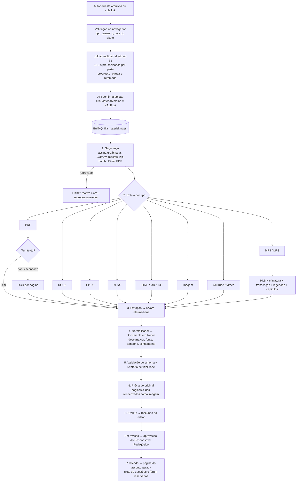
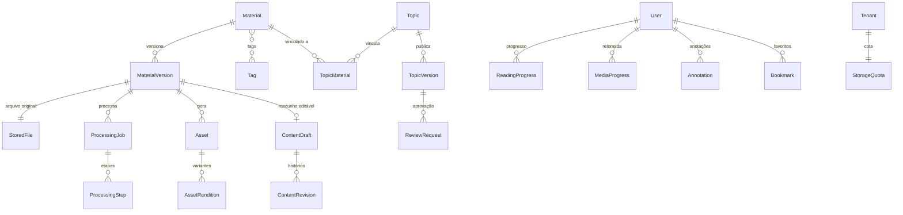

# Fase 2 — Biblioteca de Materiais: pipeline, schema de blocos e modelo de dados

> **Status:** proposta para aprovação. Nenhum código da Fase 2 foi escrito ainda.
> Complementa [`ARQUITETURA.md`](ARQUITETURA.md) (Fase 1). Decisões que pedem aprovação estão na [seção 9](#9-decisões-para-aprovação).

## Sumário

1. [Visão geral do fluxo](#1-visão-geral-do-fluxo)
2. [Central de upload](#2-central-de-upload)
3. [Pipeline de processamento](#3-pipeline-de-processamento)
4. [Ferramentas e justificativas](#4-ferramentas-e-justificativas)
5. [Schema dos blocos (formato interno)](#5-schema-dos-blocos-formato-interno)
6. [Modelo de dados](#6-modelo-de-dados)
7. [Editor, leitor, governança e proteção](#7-editor-leitor-governança-e-proteção)
8. [Testes e critérios de aceite](#8-testes-e-critérios-de-aceite)
9. [Decisões para aprovação](#9-decisões-para-aprovação)

---

## 1. Visão geral do fluxo



Cada etapa grava seu progresso em `ProcessingStep`, de modo que a interface mostra **Na fila → Processando (etapa X de Y, %) → Pronto** ou **Erro** com o motivo. As etapas são idempotentes: **reprocessar** reexecuta só a partir da etapa que falhou (ou do início, se o autor escolher).

---

## 2. Central de upload

| Requisito | Solução |
|---|---|
| Arrastar e soltar, múltiplos arquivos, progresso | **Uppy** (núcleo + Dashboard sem estilo próprio — a interface é nossa, com tokens) |
| Pausa e retomada | **Upload multipart S3** (partes de 8–16 MB, URL pré-assinada por parte). Retomada sobrevive a recarregar a página (estado das partes no IndexedDB + `ListParts` no S3) |
| Validação de tipo e tamanho | No navegador (extensão + MIME) **e** no servidor (assinatura binária real com `file-type`); limites por formato e por plano |
| Limite por plano | `StorageQuota` do tenant: espaço total, tamanho máximo por arquivo, minutos de vídeo. A API recusa a criação do upload se exceder |
| Metadados no envio | Nível › Segmento › Módulo › Assunto (seletores em cascata), título, descrição, autor responsável, tags — **todos opcionais no envio**; "Enviar agora, vincular depois" deixa o material na Biblioteca como *não vinculado* |
| Links YouTube/Vimeo | Campo "colar link"; validação do domínio e do ID, metadados via oEmbed |
| Antivírus | ClamAV (seção 4) antes de qualquer conversor tocar no arquivo |

Limites padrão propostos (configuráveis por plano): documentos 200 MB, imagens 25 MB, áudio 500 MB, vídeo 10 GB.

Na Biblioteca, cada material aparece em uma tabela com filtro por status, tipo, vínculo, autor e tags, e ações: abrir no editor, vincular, reprocessar, nova versão, arquivar.

---

## 3. Pipeline de processamento

Filas BullMQ separadas por perfil de carga, para que um vídeo de 2 horas não atrase um DOCX:

| Fila | Trabalho | Concorrência sugerida |
|---|---|---|
| `material.ingest` | segurança, roteamento, documentos (PDF, DOCX, PPTX, XLSX, HTML, MD, TXT, imagens) | alta |
| `material.ocr` | OCR de PDFs escaneados | média (CPU) |
| `media.transcode` | HLS, miniaturas | baixa (CPU intensiva) |
| `media.transcribe` | transcrição e legendas | baixa (CPU/GPU) |
| `material.preview` | renderização do original como imagens (comparação lado a lado) | média |

Tentativas automáticas: 3, com espera exponencial, só para erros transitórios (rede, S3, tempo esgotado). Erros de conteúdo (arquivo corrompido, protegido por senha, vírus) vão direto para **ERRO** com mensagem em português e código.

### O que cada formato vira

| Formato | Extração | Resultado em blocos |
|---|---|---|
| **PDF (texto)** | Análise de layout: ordem de leitura, títulos (por hierarquia visual), listas, **tabelas**, imagens, legendas; remove cabeçalho/rodapé repetidos e números de página | Seções por título de nível 1/2; `heading`, `paragraph`, `list`, `table`, `image`, `quote` |
| **PDF escaneado** | Detecção por página (pouco ou nenhum texto + imagem de página inteira) → OCR em português → mesma análise de layout | Igual ao PDF de texto; blocos marcados com `confidence` para o autor revisar trechos de baixa confiança |
| **DOCX** | Estrutura semântica (estilos "Título 1…", listas, tabelas, notas de rodapé, imagens, comentários ignorados) | Seções por `Título 1`; notas de rodapé viram `footnote` no fim da seção |
| **PPTX** | Por slide: título, caixas de texto (ordem visual), tabelas, imagens, **notas do apresentador**; imagem renderizada do slide | **Uma seção por slide** (`kind: "slide"`), com `image` do slide renderizado + texto extraído + `notes` |
| **XLSX** | Por aba: área usada, cabeçalho detectado, células mescladas, valores **já formatados** (moeda, data, %), fórmulas → valor calculado; gráficos: séries e tipo lidos do XML do gráfico | Seção por aba; `table` responsiva; `chart` temático quando o tipo é suportado (barra, coluna, linha, pizza, área), senão `image` do gráfico renderizado |
| **HTML** | Sanitização e mapeamento semântico (`h1-h6`, `p`, `ul/ol`, `table`, `img`, `blockquote`, `pre`, `figure`); `style`, `class`, `font`, scripts e iframes descartados (iframes de YouTube/Vimeo viram `video`) | Blocos equivalentes |
| **Markdown / TXT** | Markdown com GFM (tabelas, listas de tarefas); TXT: parágrafos por linha em branco, títulos por heurística conservadora (linhas curtas em caixa alta ou numeradas) | Blocos equivalentes |
| **PNG / JPG / SVG** | Otimização, variantes responsivas (AVIF/WebP 480/960/1600 px), remoção de EXIF/GPS; SVG sanitizado (sem scripts, eventos ou referências externas) | `image` (texto alternativo pedido ao autor; sugestão por OCR quando houver texto na imagem) |
| **MP4** | HLS adaptativo (360p/540p/720p/1080p conforme a origem), miniatura + *sprite* para prévia na barra, duração, transcrição, legendas WebVTT, capítulos sugeridos por pausas/mudança de assunto na transcrição | `video` (com `chapters` e `captions`) + seção "Transcrição" opcional |
| **MP3** | AAC/HLS de áudio, forma de onda, transcrição e legendas | `audio` + transcrição |
| **YouTube / Vimeo** | oEmbed: título, miniatura, duração | `video` com `embed` (player nosso via API do provedor; legendas e marca d'água dependem do provedor — ver seção 7.5) |

### Relatório de fidelidade

Ao final, o worker gera um resumo exibido no editor: "32 páginas, 14 títulos, 6 tabelas, 21 imagens, 3 trechos de OCR com baixa confiança, 2 gráficos convertidos em imagem". Isso orienta a revisão humana antes de publicar.

### Exemplos de mensagens de erro

| Código | Mensagem ao autor | Reprocessar? |
|---|---|---|
| `ARQUIVO_PROTEGIDO` | "O PDF está protegido por senha. Envie uma versão sem senha." | nova versão |
| `ARQUIVO_CORROMPIDO` | "Não foi possível abrir o arquivo; ele parece corrompido ou incompleto." | sim |
| `AMEACA_DETECTADA` | "O antivírus encontrou uma ameaça (Win.Trojan…). O arquivo foi bloqueado." | não |
| `MACRO_NAO_PERMITIDA` | "Arquivos com macros (.docm/.xlsm/.pptm) não são aceitos. Salve como .docx/.xlsx/.pptx." | nova versão |
| `FORMATO_NAO_SUPORTADO` | "O conteúdo do arquivo não corresponde à extensão .pdf." | nova versão |
| `COTA_EXCEDIDA` | "O limite de armazenamento do plano foi atingido." | após liberar espaço |
| `TEMPO_ESGOTADO` | "O processamento demorou mais que o esperado. Tente novamente." | sim |

---

## 4. Ferramentas e justificativas

Mantive LibreOffice headless, ffmpeg, Tesseract e BullMQ/Redis, como pedido. Acrescentei ferramentas onde elas resolvem algo que essas quatro não resolvem bem:

| Ferramenta | Uso | Por quê |
|---|---|---|
| **BullMQ + Redis** | Filas, tentativas, progresso, prioridade | Como pedido. |
| **LibreOffice headless** | DOCX/PPTX/XLSX → PDF para **prévia do original** e imagem de cada slide; gráficos de XLSX não suportados → imagem | Como pedido. Não é usado para extrair estrutura: a conversão para PDF/HTML pelo LibreOffice carrega a formatação original e perde a semântica (títulos viram texto grande), o oposto do que precisamos. |
| **Docling** (IBM, licença MIT) | Análise de layout e **tabelas de PDF** (ordem de leitura, títulos, listas, tabelas, legendas) | **Acréscimo.** Extrair títulos e tabelas de PDF só com texto posicionado (pdf.js/Poppler) é frágil: um PDF não tem "tabela", só traços e letras soltas. Docling usa modelos de layout e de estrutura de tabela que rodam localmente (sem enviar dados a terceiros — LGPD). Roda como **serviço interno em Python** (container `extrator`), chamado pelo worker Node. |
| **Tesseract** (via OCRmyPDF, idioma `por`) | OCR de PDFs escaneados | Como pedido. OCRmyPDF cuida de pré-processamento (desentortar, limpar) e devolve PDF com camada de texto, que segue para o Docling. Local, sem custo por página. *Alternativa para manuscritos ou baixa qualidade: AWS Textract/Google Document AI, desligado por padrão (ver D4).* |
| **Mammoth** | DOCX → estrutura semântica | **Acréscimo.** Converte por *estilo semântico* ("Título 1" → título) e ignora deliberadamente a formatação visual — exatamente a regra central. Mais fiel que passar pelo LibreOffice. |
| **Leitura direta do OOXML** (JSZip + parser XML) | Texto, ordem, notas e imagens de PPTX; gráficos de XLSX | PPTX e gráficos não têm biblioteca semântica madura; o XML do Office é aberto e estável. |
| **ExcelJS** | Células, mesclagens, formatos numéricos, valores de fórmulas | Valores formatados em pt-BR (R$, datas, %) preservados. |
| **unified (remark/rehype)** | Markdown e HTML → blocos | Padrão de mercado, com sanitização. |
| **Sharp** + **DOMPurify** | Imagens (variantes, EXIF) e sanitização de SVG | SVG pode conter script; precisa ser limpo. |
| **ffmpeg** | HLS, miniaturas, sprite, forma de onda, extração de áudio | Como pedido. |
| **faster-whisper** (modelo Whisper, local) | Transcrição pt-BR e legendas WebVTT | **Acréscimo** (o pedido não fixa a ferramenta). Qualidade alta em português, roda localmente (LGPD); em CPU é lento, com GPU fica perto do tempo real. *Alternativa: API de transcrição paga por minuto (ver D5).* |
| **ClamAV** (clamd) | Antivírus | Livre, assinaturas atualizadas por `freshclam`, roda em container. |
| **qpdf** | Detecta e remove JavaScript/anexos embutidos em PDF; valida estrutura | Defesa em profundidade antes do Docling. |
| **pdf-lib** | Marca d'água nos PDFs baixados pelo aluno | Leve, sem dependências nativas. |
| **hls.js** | Player de vídeo no navegador (interface nossa) | Controle total do visual com tokens. |

### Mudança em relação à Fase 1 (D5)

Na Fase 1 recomendei Bunny Stream para vídeo. Como agora o pedido é explicitamente **ffmpeg + HLS próprio**, a proposta passa a ser HLS próprio no S3, com chave de criptografia AES-128 entregue apenas a sessões autorizadas. A interface do player é a mesma nos dois casos, então a troca futura por um provedor gerenciado continua possível.

### Topologia de containers

```
web (Next.js) ──► Redis ◄── worker (Node, BullMQ) ──► extrator (Python: Docling + OCRmyPDF/Tesseract)
                                 │                └─► transcritor (Python: faster-whisper)  [GPU opcional]
                                 ├─► clamd (ClamAV)
                                 └─► LibreOffice, ffmpeg, qpdf (no próprio container do worker)
```

---

## 5. Schema dos blocos (formato interno)

Evolução do schema proposto na Fase 1 (seção 8 de `ARQUITETURA.md`). Continua valendo a regra: **nenhum campo de aparência** (cor, fonte, tamanho, alinhamento, espaçamento) e **nenhum HTML livre**. Validado com Zod em `packages/content-blocks`; versionado por `schemaVersion` com migrações.

```ts
// Documento produzido por qualquer conversor e editado no editor de blocos
interface ContentDocument {
  schemaVersion: 2;
  title: string;
  sections: Section[];            // base do índice automático e da navegação lateral
  meta: {
    language: "pt-BR" | string;
    source: { materialVersionId: string; format: SourceFormat; pages?: number; slides?: number; sheets?: string[] };
    stats: { headings: number; tables: number; images: number; lowConfidenceBlocks: number };
  };
}

interface Section {
  id: string;                     // estável entre edições (ancora progresso, anotações, favoritos)
  kind: "section" | "slide" | "sheet" | "transcript";
  title: string;
  blocks: Block[];
  slide?: { number: number; imageAssetId?: string; notes?: Inline[][] }; // PPTX
  source?: SourceRef;
}

type Block = BlockBase & (
  | { type: "heading";   level: 2 | 3 | 4; text: Inline[] }
  | { type: "paragraph"; text: Inline[] }
  | { type: "list";      style: "bullet" | "ordered" | "check"; items: ListItem[] }
  | { type: "table";     caption?: Inline[]; header: Cell[][]; rows: Cell[][]; numericColumns?: number[] }
  | { type: "image";     assetId: string; alt: string; caption?: Inline[]; role?: "figure" | "slide" | "chart" }
  | { type: "chart";     chartType: "bar" | "column" | "line" | "area" | "pie";
                         categories: string[]; series: { name: string; values: (number | null)[] }[];
                         valueFormat?: "number" | "currency-BRL" | "percent"; caption?: Inline[] }
  | { type: "video";     assetId?: string; embed?: { provider: "youtube" | "vimeo"; id: string };
                         posterAssetId?: string; durationSec?: number;
                         captions?: Caption[]; chapters?: Chapter[] }
  | { type: "audio";     assetId: string; durationSec?: number; captions?: Caption[]; chapters?: Chapter[] }
  | { type: "quote";     text: Inline[]; cite?: string }
  | { type: "callout";   variant: "destaque" | "dica" | "atencao" | "exemplo" | "info"; title?: string; blocks: Block[] }
  | { type: "code";      language?: string; code: string }
  | { type: "divider" }
  | { type: "attachment"; assetId: string; label: string; downloadPolicy: "inherit" | "allowed" | "blocked" }
  | { type: "footnotes"; items: { id: string; text: Inline[] }[] }
  // Slots reservados — o renderizador mostra "Disponível em breve" até a Fase 3 ativar:
  | { type: "questionSlot"; bankRef?: string }
  | { type: "forumSlot" }
);

interface BlockBase {
  id: string;                     // estável; hash do conteúdo na criação
  source?: SourceRef;             // liga o bloco ao trecho do original (comparação lado a lado)
  confidence?: number;            // 0–1, só para OCR/extração incerta → sinalizado no editor
}

interface SourceRef { page?: number; slide?: number; sheet?: string; range?: string; bbox?: [number, number, number, number] }

type Inline =
  | { kind: "text"; text: string; marks?: ("bold" | "italic" | "underline" | "code" | "sub" | "sup")[] }
  | { kind: "link"; text: string; href: string }        // http(s) e mailto apenas
  | { kind: "footnoteRef"; footnoteId: string };

interface Caption { lang: string; label: string; assetId: string }   // WebVTT
interface Chapter { startSec: number; title: string }
interface ListItem { text: Inline[]; children?: ListItem[]; checked?: boolean }
interface Cell { text: Inline[]; colSpan?: number; rowSpan?: number; header?: boolean }
```

Como cada tipo é desenhado no tema:

| Bloco | Renderização (somente tokens) |
|---|---|
| `heading` | `--font-display`, escala `--text-xl…3xl`; entra no índice |
| `paragraph`, `list`, `quote`, `footnotes` | `--font-body`, `--leading-normal`, largura de leitura ~72 caracteres; citação com filete `--color-accent` |
| `table` | Componente `Table` do DS; no celular vira rolagem horizontal *dentro do bloco* com primeira coluna fixa, ou cartões empilhados quando há até 4 colunas; números alinhados à direita com `tabular-nums` |
| `chart` | Componente de gráfico com a paleta categórica derivada dos tokens; troca de tema recolore |
| `image` | Moldura `--radius-lg`, legenda `--color-text-muted`, `srcset` responsivo, ampliação em modal |
| `video` / `audio` | Player temático próprio (seção 7.4) |
| `callout` | Variantes com ícone e cor de estado do tema (`destaque` = dourado, `dica` = índigo, `atencao` = alerta, `exemplo` = superfície elevada, `info` = neutro) |
| `code` | `--font-mono`, superfície `--color-surface-raised`, realce de sintaxe com tokens |

> **Sobre imagens, slides e gráficos rasterizados:** os pixels de uma imagem são conteúdo e não são recoloridos — o que segue o tema é tudo ao redor (moldura, legenda, tipografia, espaçamento). Por isso, no PPTX o texto do slide é sempre extraído como blocos temáticos, e a imagem do slide é opcional (decisão D2). Em gráficos de XLSX, priorizamos o bloco `chart` temático e só caímos para imagem quando o tipo de gráfico não é suportado.

---

## 6. Modelo de dados

Novas entidades (convenções da Fase 1: UUID v7, `tenantId` + RLS, auditoria).



| Entidade | Campos principais | Observações |
|---|---|---|
| `Material` | tenantId, titulo, descricao, tipo (`DOCUMENTO`/`APRESENTACAO`/`PLANILHA`/`IMAGEM`/`VIDEO`/`AUDIO`/`LINK`), autorResponsavelId, currentVersionId, status (`RASCUNHO`/`EM_REVISAO`/`PUBLICADO`/`ARQUIVADO`), allowOriginalDownload, createdById | "Não vinculado" = sem `TopicMaterial`. |
| `MaterialVersion` | materialId, numero, storedFileId, processingStatus (`ENVIANDO`/`NA_FILA`/`PROCESSANDO`/`PRONTO`/`ERRO`), errorCode, errorMessage, fidelityReport (JSONB), document (JSONB `ContentDocument` extraído, imutável), createdById | Nova versão = novo arquivo. O extraído nunca é sobrescrito. |
| `StoredFile` | bucketKey, nomeOriginal, mime (detectado), tamanho, sha256, scanStatus (`PENDENTE`/`LIMPO`/`INFECTADO`), scanSignature, uploadId (multipart) | `sha256` evita duplicados e serve de prova de integridade. |
| `ProcessingJob` | materialVersionId, fila, tentativa, status, iniciadoEm, finalizadoEm, workerId | Um job por execução (reprocessar cria outro, preservando o histórico). |
| `ProcessingStep` | jobId, etapa (`SEGURANCA`/`OCR`/`EXTRACAO`/`NORMALIZACAO`/`VALIDACAO`/`PREVIA`/`TRANSCODIFICACAO`/`TRANSCRICAO`), status, progresso (%), log, erro | Alimenta a barra de status e o "reprocessar a partir daqui". |
| `Asset` | materialVersionId, tipo (`IMAGEM`/`SLIDE`/`GRAFICO`/`PAGINA_PREVIA`/`HLS`/`MINIATURA`/`SPRITE`/`LEGENDA`/`TRANSCRICAO`/`FORMA_ONDA`/`ANEXO`), bucketKey, mime, largura, altura, duracaoSec, meta (JSONB) | Tudo que o leitor exibe é um `Asset`, servido por URL assinada. |
| `AssetRendition` | assetId, variante (`480w.avif`, `720p`, …), bucketKey, tamanho | Variantes responsivas e escada HLS. |
| `ContentDraft` | materialVersionId, document (JSONB), lockedById, lockedAt, updatedById | O que o editor altera. Trava otimista para edição concorrente. |
| `ContentRevision` | draftId, numero, patch (JSON Patch RFC 6902), snapshot (JSONB a cada N revisões), autorId, resumo ("moveu 3 blocos; editou tabela 2"), createdAt | Histórico "quem, quando, o quê"; **restaurar** cria uma nova revisão com o estado antigo (nada é apagado). |
| `TopicMaterial` | topicId, materialId, ordem, papel (`PRINCIPAL`/`COMPLEMENTAR`) | Um assunto pode combinar vídeo + PDF + planilha. |
| `TopicVersion` (estende Fase 1) | + document (JSONB: composição publicada), materialVersionIds[], publishedById, publishedAt, slots `questionSlot`/`forumSlot` | **Imutável.** O aluno sempre lê uma versão publicada congelada. |
| `ReviewRequest` | topicVersionId, solicitanteId, revisorId, status (`PENDENTE`/`APROVADO`/`DEVOLVIDO`), comentarios (JSONB por bloco), decididoEm | Fluxo de aprovação pelo Responsável Pedagógico. |
| `Tag` / `MaterialTag` | tenantId, nome, slug | |
| `StorageQuota` | tenantId, bytesLimite, bytesUsados, maxArquivoBytes, minutosVideoLimite | Atualizada a cada upload/exclusão. |
| `ReadingProgress` | userId, topicVersionId, lastSectionId, lastBlockId, percentual, sectionsConcluidas[], concluidoEm | "Retomar de onde parou". |
| `MediaProgress` | userId, assetId, posicaoSec, velocidade, legendaLang, concluido | Retomada do player. |
| `Annotation` | userId, topicId, topicVersionId, blockId, rangeStart, rangeEnd, textoCitado, nota, cor (`amarelo`/`azul`/… → mapeadas a tokens), orfa | Ao surgir nova versão, a âncora é reposicionada pelo `blockId` + texto citado; sem correspondência, vira "anotação sem âncora" (nunca é perdida). |
| `Bookmark` | userId, topicId, sectionId, blockId, rotulo | Favoritos. |
| `ReaderPreference` | userId, escalaFonte (90–150%), modoLeitura, tema (`system`/`dark`/`light`) | Preferências do leitor. |

Alterações em entidades da Fase 1: `Topic` ganha `downloadPolicy` (`LIBERADO`/`BLOQUEADO`/`COM_MARCA_DAGUA`), `Module` ganha a política padrão herdada pelos assuntos e `AuditLog` passa a registrar uploads, publicações, restaurações e downloads de originais.

---

## 7. Editor, leitor, governança e proteção

### 7.1 Editor de blocos

- Lista de seções à esquerda (arrastar para reordenar seções), blocos ao centro (arrastar para reordenar, menu "/" para inserir).
- Operações: editar texto, trocar imagem (novo upload ou da Biblioteca), editar tabela célula a célula, **dividir seção** no bloco selecionado, **juntar** com a seção seguinte, inserir `callout` (destaque, dica, atenção, exemplo), divisor, anexo, vídeo.
- Blocos de baixa confiança (OCR) sinalizados para revisão; o relatório de fidelidade fica fixo no topo.
- Salvamento automático a cada alteração (revisão no histórico), desfazer/refazer.

### 7.2 Pré-visualização

- Alternância **Celular (390 px) / Tablet (820 px) / Desktop (1280 px)** e **claro/escuro**, renderizando o mesmo `BlockRenderer` do aluno em um iframe com largura fixa — o que se vê é exatamente o que o aluno verá.

### 7.3 Comparação lado a lado

- Esquerda: **o original renderizado como imagem** (páginas do PDF, páginas do DOCX convertido pelo LibreOffice, slides do PPTX, abas do XLSX). Não usamos o visualizador nativo do arquivo.
- Direita: a versão da plataforma. Graças ao `source` de cada bloco, clicar em um bloco destaca a área correspondente no original e as duas colunas rolam sincronizadas.

### 7.4 Leitor temático (aluno)

- Navegação lateral por seções (gaveta no celular), índice automático a partir de seções e títulos, barra de progresso de leitura, **marcar seção/assunto como concluído**, retomar de onde parou.
- **Anotações, destaque de texto e favoritos**: selecionar texto abre o menu "Destacar / Anotar / Copiar link"; painel "Minhas anotações" por assunto.
- **Player de vídeo/áudio próprio** (hls.js): velocidade 0,5–2×, legendas WebVTT, capítulos na barra de tempo e na lista, retomada, atalhos de teclado, miniatura ao passar o mouse, totalmente acessível.
- **Modo leitura** (oculta navegação, coluna única), claro/escuro, **tamanho da fonte** (90–150% — altera só `--text-*` do leitor), **impressão limpa** (CSS de impressão: sem navegação, tabelas sem corte, links com URL, marca d'água do aluno no rodapé).
- Materiais complementares: botão de download conforme a política (liberado, bloqueado ou liberado com marca d'água).

### 7.5 Governança e proteção

- **Status:** Rascunho → Em revisão → Publicado → Arquivado. Autor envia para revisão; **Responsável Pedagógico** do módulo aprova (publica) ou devolve com comentários por bloco. Admin pode publicar diretamente (registrado em auditoria).
- **Publicar** congela uma `TopicVersion` e gera a página do assunto com: conteúdo, player, materiais complementares e os slots `questionSlot` e `forumSlot` (exibidos como "Em breve" até a Fase 3).
- **Versionamento:** histórico de revisões e de versões publicadas, com diferença visual entre versões e **restaurar** (gera nova revisão).
- **URLs assinadas e expiráveis** (5 min para imagens/anexos; playlists HLS com chave AES-128 entregue por endpoint autenticado, validade curta e vinculada à sessão).
- **Marca d'água:**
  - *PDF baixado*: gerado na hora do download com nome, CPF parcial (`***.456.789-**`), e-mail e data em todas as páginas (pdf-lib); nunca há um PDF "limpo" por URL pública.
  - *Vídeo*: sobreposição dinâmica no player, com posição que muda periodicamente, nome e CPF parcial. Limitação honesta: isso desestimula a gravação de tela e identifica vazamentos, mas não é gravada nos pixels do vídeo. Gravar a marca em cada vídeo por aluno exigiria transcodificar uma cópia por aluno (custo inviável); a alternativa de mercado é *watermarking* forense via provedor (ver D6).
  - *Vídeos de YouTube/Vimeo*: a marca d'água sobreposta funciona, mas URLs assinadas e bloqueio dependem do provedor (Vimeo com privacidade por domínio; YouTube "não listado" não é protegido). Recomendação: conteúdo pago em MP4 próprio.
- **Bloqueio de download do original** por material, por assunto ou por módulo; quando bloqueado, o original só é acessível a autores/admin.

---

## 8. Testes e critérios de aceite

### Arquivos de exemplo

`packages/fixtures/` com **um arquivo de cada formato gerado por script** (sem direitos autorais de terceiros), cobrindo os casos difíceis: PDF com tabelas e duas colunas, PDF escaneado, DOCX com títulos/listas aninhadas/tabela/imagem/nota de rodapé, PPTX com notas, XLSX com células mescladas, moeda e um gráfico, HTML com estilos inline agressivos, Markdown com GFM, TXT, PNG, JPG, SVG com script malicioso (deve ser limpo), MP4 de 10 s com fala, MP3, arquivo EICAR (teste de antivírus), PDF com senha e DOCX corrompido.

### Camadas de teste

| Camada | O que verifica |
|---|---|
| Unitário (Vitest) | Cada conversor: arquivo de exemplo → `ContentDocument` válido no schema; comparação com *golden file* JSON (números de títulos, tabelas, imagens, seções/slides) |
| Integração (worker + containers) | Fila completa: status NA_FILA → PROCESSANDO → PRONTO; erros esperados (EICAR, senha, corrompido) → ERRO com código correto; reprocessar funciona |
| E2E (Playwright) | Fluxo de aceite abaixo, em 390 px e 1280 px, claro e escuro |
| Regra central | Varredura do DOM do leitor: nenhum atributo `style` vindo do conteúdo, nenhuma fonte fora de `--font-*`, cores computadas pertencem ao conjunto de tokens; arquivo HTML/DOCX "hostil" com cores e fontes exóticas sai idêntico em aparência a um "limpo" |
| Acessibilidade | axe-core sem violações no leitor, editor, player e upload |
| Celular | Nenhuma rolagem horizontal da página em 360 px (tabelas rolam só dentro do bloco) |

### Critérios de aceite da Fase 2

- [ ] Subir PDF, DOCX, PPTX, XLSX e MP4 (fixtures) e ver cada um publicado como página temática, sem ajuste manual de estilo.
- [ ] Texto, tabelas e imagens preservados e legíveis em celular (360 px, sem rolagem horizontal da página).
- [ ] Falha de conversão mostra erro claro em português e botão de reprocessar (testado com arquivo corrompido e com falha simulada).
- [ ] Alterar cores/fonte em **Configurações e Tema** muda todos os conteúdos já publicados, sem republicar (teste E2E compara cores computadas antes/depois).
- [ ] PPTX: uma seção navegável por slide, com texto e notas. XLSX: tabela responsiva e gráfico temático.
- [ ] MP4: HLS com troca de qualidade, miniatura, legendas pt-BR e retomada.
- [ ] PDF escaneado gera texto pesquisável por OCR.
- [ ] Download do PDF com marca d'água do aluno; download bloqueado quando configurado; URLs expiram.
- [ ] Fluxo rascunho → revisão → publicado com aprovação do Responsável Pedagógico e histórico com restauração.

---

## 9. Decisões para aprovação

| # | Decisão | Recomendação |
|---|---|---|
| D1 | Acrescentar **Docling** (serviço Python) para layout e tabelas de PDF, além de LibreOffice/Tesseract | ✅ Sem ele, títulos e tabelas de PDF ficam pouco confiáveis |
| D2 | PPTX: exibir a **imagem do slide** junto do texto extraído (a imagem mantém o visual original do slide) | Exibir como figura recolhível, com opção por material de ocultar e mostrar só o texto temático |
| D3 | Gráficos de XLSX como **componente temático** quando suportado, imagem nos demais casos | ✅ |
| D4 | OCR: Tesseract local; serviço em nuvem (Textract/Document AI) apenas opcional | ✅ Local por padrão (custo e LGPD) |
| D5 | Transcrição: **faster-whisper local** (exige GPU para vídeos longos em tempo razoável) ou **API paga por minuto** | Local se houver GPU na hospedagem; senão API, com cláusula de tratamento de dados (LGPD) |
| D6 | Marca d'água em vídeo: **sobreposição dinâmica no player** (incluída) e, opcionalmente, *watermarking* forense via provedor | Sobreposição agora; forense só se houver risco real de pirataria |
| D7 | Vídeo em HLS próprio (substitui a recomendação Bunny Stream da Fase 1/D5) | ✅ Conforme pedido |
| D8 | Limites padrão de tamanho (seção 2) | Ajustar conforme os planos comerciais |
