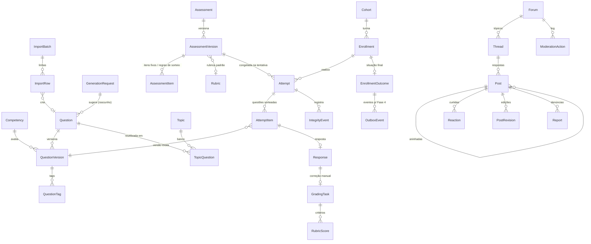
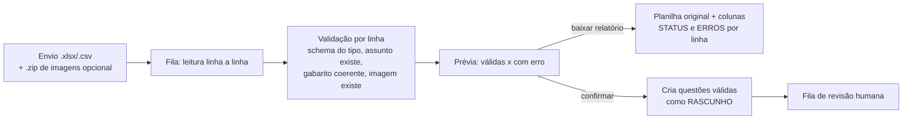
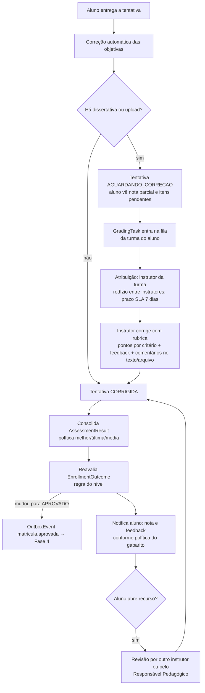

# Fase 3 — Questões, Avaliações, Fórum e Desempenho: modelo de dados, regras de aprovação e fluxo de correção

> **Status:** proposta para aprovação. Nenhum código da Fase 3 foi escrito ainda.
> Complementa [`ARQUITETURA.md`](ARQUITETURA.md) (Fase 1) e [`FASE-2-BIBLIOTECA.md`](FASE-2-BIBLIOTECA.md) (Fase 2). As decisões que pedem aprovação estão na [seção 10](#10-decisões-para-aprovação).

## Sumário

1. [Princípios](#1-princípios)
2. [Modelo de dados](#2-modelo-de-dados)
3. [Tipos de questão e regras de pontuação](#3-tipos-de-questão-e-regras-de-pontuação)
4. [Importação por planilha e geração assistida](#4-importação-por-planilha-e-geração-assistida)
5. [Avaliações: execução, tempo e anticola](#5-avaliações-execução-tempo-e-anticola)
6. [Fluxo de correção](#6-fluxo-de-correção)
7. [Regras de aprovação por nível](#7-regras-de-aprovação-por-nível)
8. [Fórum e comunidade](#8-fórum-e-comunidade)
9. [Acompanhamento, relatórios, acessibilidade e LGPD](#9-acompanhamento-relatórios-acessibilidade-e-lgpd)
10. [Decisões para aprovação](#10-decisões-para-aprovação)
11. [Testes e critérios de aceite](#11-testes-e-critérios-de-aceite)

---

## 1. Princípios

1. **Nota lançada é imutável.** Cada resposta aponta para uma *versão congelada* da questão e da configuração da avaliação. Editar uma questão cria uma nova versão; as notas existentes não mudam. A única forma de alterar uma nota já lançada é uma **recorreção explícita** (seção 6.4), registrada em auditoria e comunicada ao aluno.
2. **O servidor é a autoridade.** Gabarito, cronômetro, sorteio e pontuação vivem no servidor. O navegador nunca recebe o gabarito antes da entrega, e o tempo é calculado pelo relógio do servidor.
3. **Tudo é renderizado com o tema.** Enunciados, alternativas, feedbacks, rubricas e posts do fórum usam o mesmo formato de blocos da Fase 2 e o mesmo `BlockRenderer`. Os slots `questionSlot` e `forumSlot` reservados na Fase 2 passam a ser ativados automaticamente.
4. **Aprovação é um cálculo reproduzível.** Uma regra declarativa por nível, avaliada sobre dados registrados. O resultado e a "explicação" (quais critérios passaram) ficam gravados, e cada mudança dispara eventos para a Fase 4 (certificados).
5. **Registrar, não punir.** Os sinais de integridade (troca de aba, IP, sessão) são evidências para o instrutor, nunca causa de reprovação automática.

---

## 2. Modelo de dados

Convenções das fases anteriores: UUID v7, `tenantId` com RLS em todas as tabelas, auditoria, datas em UTC.

### 2.1 Diagrama

### 2.2 Banco de questões

| Entidade | Campos principais | Observações |
|---|---|---|
| `Competency` | tenantId, codigo, nome, descricao, parentId, segmentId (opcional) | Árvore de competências (ex.: "Finanças › Fluxo de caixa › Projeção"). Base dos relatórios de pontos fracos. |
| `Question` | tenantId, currentVersionId, status (`RASCUNHO`/`EM_REVISAO`/`APROVADA`/`ARQUIVADA`), origem (`MANUAL`/`PLANILHA`/`GERADA`/`EXTRAIDA`), externalId (para reimportar sem duplicar), createdById | Identidade estável da questão. |
| `QuestionVersion` | questionId, numero, tipo, enunciado (blocos), payload (JSONB por tipo — seção 3), feedbackGeral (blocos), dificuldade (`FACIL`/`MEDIA`/`DIFICIL`), pontuacao, competencyId, tempoEstimadoSec, fonte (`SourceRef` → bloco do material), aprovadaPorId, aprovadaEm | **Imutável depois de aprovada.** Editar cria nova versão em `RASCUNHO`. |
| `QuestionTag` | questionVersionId, tagId | Reaproveita `Tag` da Fase 2. |
| `TopicQuestion` | topicId, questionId, ordem | **Reutilização entre assuntos**: a mesma questão pode estar no banco de vários assuntos. |
| `QuestionReview` | questionVersionId, revisorId, decisao (`APROVADA`/`DEVOLVIDA`), comentarios | Revisão humana obrigatória para entrar no banco. |
| `ImportBatch` | arquivo (`StoredFile`), status, totalLinhas, validas, comErro, relatorioKey, criadoPorId | Importação por planilha. |
| `ImportRow` | batchId, linha, dados (JSONB), erros (`[{coluna, mensagem}]`), questionId | Relatório de erros por linha. |
| `GenerationRequest` | topicId, materialVersionId, parametros (quantidade, tipos, dificuldade), status, custo, criadoPorId | Geração assistida (seção 4.2). |

### 2.3 Avaliações e tentativas

| Entidade | Campos principais | Observações |
|---|---|---|
| `Assessment` | tenantId, tipo (`QUIZ`/`PROVA_MODULO`/`PROVA_FINAL`/`DIAGNOSTICA`), escopo (topicId **ou** moduleId), titulo, currentVersionId, status | |
| `AssessmentVersion` | assessmentId, numero, config (JSONB — seção 5.1), publicadaEm | Congelada ao ser publicada; tentativas apontam para a versão vigente quando começaram. |
| `AssessmentItem` | assessmentVersionId, ordem, modo (`FIXA`/`SORTEIO`), questionVersionId (fixa), regraSorteio (`{fonte: topicIds[], tags[], competencias[], dificuldade, quantidade}`), peso | Mistura de questões fixas e blocos sorteados. |
| `Cohort` (**nova**) | tenantId, moduleId, nome, instrutores[], inicio, fim, capacidade | **Turma.** Não existia no modelo da Fase 1 e é necessária para o fórum por turma, a fila de correção e os relatórios de instrutor. `Enrollment` ganha `cohortId`. |
| `Attempt` | enrollmentId, assessmentVersionId, numero, status (`EM_ANDAMENTO`/`ENTREGUE`/`AGUARDANDO_CORRECAO`/`CORRIGIDA`/`EXPIRADA`/`ANULADA`), iniciadaEm, prazoEm (com tempo adicional já somado), entregueEm, entregaAutomatica, sessionId, ip, userAgent, notaBruta, notaFinal, seed | `seed` reproduz o sorteio e o embaralhamento. |
| `AttemptItem` | attemptId, ordem, questionVersionId, permutacao (ordem das alternativas mostrada), peso | Exatamente o que o aluno viu. |
| `Response` | attemptItemId, resposta (JSONB), salvaEm, pontuacaoAuto, pontuacaoManual, pontuacaoFinal, status (`PENDENTE`/`CORRIGIDA_AUTO`/`AGUARDANDO_MANUAL`/`CORRIGIDA_MANUAL`) | Salva automaticamente a cada alteração. Upload aponta para `StoredFile` (passa pelo antivírus da Fase 2). |
| `Rubric` / `RubricCriterion` / `RubricLevel` | nome; critério (descrição, peso); nível (rótulo, pontos, descrição) | Rubricas reutilizáveis. |
| `GradingTask` | responseId, cohortId, atribuidoA, status (`NA_FILA`/`EM_CORRECAO`/`CORRIGIDA`/`EM_RECURSO`), prazoSla, anonima | Fila de correção manual. |
| `RubricScore` | gradingTaskId, criterionId, levelId, pontos, comentario | |
| `GradeFeedback` | gradingTaskId, feedback (blocos), anotacoes (comentários ancorados ao texto ou arquivo) | |
| `GradeAppeal` | responseId, alunoId, motivo, status, decisao, decididoPorId | Recurso do aluno. |
| `RegradeOperation` | questionVersionId, motivo, novaChave, escopo (tentativas afetadas), executadoPorId, resumo (antes/depois) | Recorreção explícita (seção 6.4). |
| `IntegrityEvent` | attemptId, tipo (`ABA_OCULTA`/`ABA_VISIVEL`/`FOCO_PERDIDO`/`IP_ALTERADO`/`OUTRA_SESSAO`/`RECONEXAO`/`COLAR_TEXTO`), ocorridoEm, dados | Só registro. |
| `LearnerAccommodation` | enrollmentId ou userId, tempoAdicionalPct, validade, concedidoPorId, observacao | **Nunca guarda diagnóstico**, só a adaptação (seção 9.4). |
| `AssessmentResult` | enrollmentId, assessmentId, politica (`MELHOR`/`ULTIMA`/`MEDIA`), notaConsiderada, aprovado, tentativasUsadas | Consolida as tentativas. |
| `EnrollmentOutcome` | enrollmentId, regra (snapshot), status (`EM_ANDAMENTO`/`AGUARDANDO_CORRECAO`/`APROVADO`/`REPROVADO`/`EXPIRADO`), criterios (JSONB com cada critério, valor e resultado), notaFinal, frequencia, avaliadoEm | Situação do aluno no módulo, com explicação. |
| `OutboxEvent` | tipo (`matricula.aprovada`, `matricula.aprovacao_revisada`, …), payload, publicadoEm | *Transactional outbox*: o evento é gravado na mesma transação da aprovação e publicado na fila depois, sem risco de "aprovou e o certificado não saiu". |

### 2.4 Fórum e comunidade

| Entidade | Campos principais | Observações |
|---|---|---|
| `Forum` | tenantId, escopo (`ASSUNTO`/`MODULO`/`TURMA`), topicId/moduleId/cohortId, ativo, regrasId | Criado automaticamente ao publicar um assunto, módulo ou turma. |
| `Thread` | forumId, autorId, titulo, status (`ABERTO`/`TRANCADO`), fixado, oculto, melhorRespostaId, respondidoPorEquipeEm, ultimaAtividadeEm, tags[] | "Sem resposta" = sem resposta da equipe e sem melhor resposta. |
| `Post` | threadId, parentId, autorId, corpo (blocos — subconjunto), anexos (`Asset`), seloAutor (`INSTRUTOR`/`MENTOR`/`AUTOR`/null, gravado no momento do post), oculto, ocultoMotivo, editadoEm, searchVector | Corpo em blocos: formatação rica sem HTML livre. |
| `PostRevision` | postId, corpo, editadoPorId, editadoEm, motivo | Edições (do autor ou do moderador) preservadas. |
| `Reaction` | postId, userId, tipo (`CURTIR`) | Único por (post, usuário). |
| `Mention` | postId, mencionadoId | Gera notificação. |
| `ThreadSubscription` | threadId, userId | Seguir tópico. |
| `Report` | postId, denuncianteId, motivo (`SPAM`/`OFENSIVO`/`FORA_DO_TEMA`/`DADOS_PESSOAIS`/`OUTRO`), detalhe, status | |
| `ModerationAction` | forumId, alvo (post/tópico/usuário), acao (`OCULTAR`/`REEXIBIR`/`EDITAR`/`FIXAR`/`DESAFIXAR`/`TRANCAR`/`DESTRANCAR`/`BANIR`/`DESBANIR`/`EXCLUIR`), motivo, antes/depois, moderadorId, criadoEm | **Somente inserção**: log de moderação. |
| `CommunityBan` | userId, escopo (fórum, módulo ou tenant), ate, motivo, aplicadoPorId | Banimento por prazo. |
| `CommunityRules` | tenantId, versao, conteudo (blocos), publicadoEm | Aceite obrigatório antes do primeiro post (registrado em `Consent`). |
| `Notification` | userId, tipo, dados, lidaEm, canal | No app. |
| `NotificationPreference` | userId, tipo, canal (`APP`/`EMAIL`), frequencia (`IMEDIATA`/`DIARIA`/`SEMANAL`/`DESLIGADA`) | Resumo semanal por e-mail. |
| `PointsLedger` | userId, tenantId, evento, pontos, referencia, criadoEm | Gamificação (opcional), somente inserção. |
| `Badge` / `UserBadge` | nome, criterio, icone; userId, badgeId, concedidoEm | |

---

## 3. Tipos de questão e regras de pontuação

O `payload` de cada `QuestionVersion` é validado por um schema Zod específico do tipo. Pontuação sempre normalizada para `0…pontuacao` da questão.

| Tipo | Payload | Correção | Pontuação |
|---|---|---|---|
| **Múltipla escolha — uma correta** | alternativas[] (blocos + feedback por alternativa), correta | Automática | Tudo ou nada |
| **Múltipla escolha — várias corretas** | alternativas[], corretas[], modoParcial | Automática | Padrão *proporcional com desconto*: (acertos − erros marcados) ÷ total de corretas, mínimo 0. Alternativa: tudo ou nada (D2) |
| **Verdadeiro/Falso** | afirmação, valor, feedback V/F | Automática | Tudo ou nada |
| **Associação** | colunaA[], colunaB[] (pode ter distratores extras), pares corretos | Automática | Proporcional por par correto |
| **Completar lacunas** | texto com marcadores `{{1}}`, por lacuna: respostas aceitas[], ou lista de opções, regras (ignorar maiúsculas, acentos, espaços; tolerância numérica ±x) | Automática | Proporcional por lacuna |
| **Dissertativa** | limite de palavras, rubrica, resposta-modelo (só equipe) | Manual | Rubrica |
| **Upload de trabalho** | tipos permitidos, tamanho máximo, rubrica | Manual | Rubrica |
| **Estudo de caso** | texto-base (blocos: texto, imagem, tabela), subquestões[] (qualquer tipo acima) | Mista | Soma ponderada das subquestões |

Feedback: cada alternativa pode ter comentário próprio, e cada questão tem um comentário geral. O que o aluno vê depende da política de liberação do gabarito (seção 5.1).

---

## 4. Importação por planilha e geração assistida

### 4.1 Importação por planilha

**Modelo para baixar** (`modelo-questoes.xlsx`), com aba "Instruções", aba "Exemplos" (uma linha por tipo) e aba "Questões" com listas suspensas validadas:

| Coluna | Obrigatória | Exemplo |
|---|:-:|---|
| `id_externo` | — | `FIN-001` (reimportar atualiza em vez de duplicar) |
| `assunto` | ✅ | caminho ou slug (`cursos/financas/fluxo-de-caixa/projecao`) |
| `tipo` | ✅ | `MULTIPLA_UMA`, `MULTIPLA_VARIAS`, `VF`, `ASSOCIACAO`, `LACUNAS`, `DISSERTATIVA`, `UPLOAD` |
| `enunciado` | ✅ | texto (aceita Markdown simples) |
| `imagem_enunciado` | — | nome do arquivo no `.zip` enviado junto, ou URL |
| `alt_a` … `alt_f` | conforme tipo | texto da alternativa |
| `correta` | conforme tipo | `B` ou `A;C` ou `V`/`F`; associação `1-C;2-A;3-B`; lacunas `1=receita|faturamento;2=custo` |
| `feedback_a` … `feedback_f`, `feedback_geral` | — | texto |
| `dificuldade` | ✅ | `FACIL` / `MEDIA` / `DIFICIL` |
| `pontuacao` | ✅ | `1` |
| `competencia` | — | código (`FIN.FC.01`) |
| `tags` | — | `fluxo;caixa;projecao` |

Fluxo:

Mensagens por linha, em português e apontando a coluna. Exemplos: "Linha 17, coluna `correta`: a alternativa E foi indicada como correta, mas `alt_e` está vazia."; "Linha 23, coluna `assunto`: assunto não encontrado."; "Linha 31: tipo VF exige `correta` igual a V ou F." As linhas válidas podem ser importadas mesmo que outras tenham erro. A importação é idempotente por `id_externo`.

### 4.2 Geração assistida a partir do material

- O autor escolhe o assunto, a quantidade, os tipos e a dificuldade. O worker envia **apenas o conteúdo do material** (blocos publicados do assunto) a um modelo de linguagem — proposta: **Claude, via API da Anthropic** — e pede questões no schema da plataforma, com a referência dos blocos que fundamentam cada uma.
- Toda questão gerada entra como `RASCUNHO` com origem `GERADA` e a fonte ligada ao trecho do material. O revisor vê, lado a lado, a questão e o trecho de origem, e aprova, edita ou descarta. **Nada entra no banco sem aprovação humana.**
- Validações automáticas antes da revisão: schema válido, gabarito coerente, sem alternativas duplicadas, enunciado que não entrega a resposta.
- LGPD: nenhum dado de aluno é enviado; só o material do tenant. Contrato com o provedor sem uso dos dados para treinamento (D6).
- A mesma interface de revisão atende as questões **extraídas de arquivos** (ex.: uma lista de exercícios em PDF convertida pela Fase 2).

---

## 5. Avaliações: execução, tempo e anticola

### 5.1 Configuração (`AssessmentVersion.config`)

| Opção | Valores |
|---|---|
| Nota mínima | 0–100% (padrão 70%) |
| Tentativas | 1–N ou ilimitadas; intervalo mínimo entre tentativas; política de nota `MELHOR` / `ULTIMA` / `MEDIA` |
| Tempo limite | minutos ou sem limite; tempo adicional por aluno (seção 9.4) |
| Sorteio | itens fixos e/ou regras de sorteio do banco (por assunto, tags, competência, dificuldade, quantidade) |
| Embaralhamento | ordem das questões e/ou das alternativas |
| Janela de disponibilidade | abre em / fecha em (fuso `America/Sao_Paulo`) |
| Navegação | livre ou sequencial (sem voltar) |
| Liberação do gabarito | `IMEDIATA` (feedback por alternativa ao entregar), `APOS_PRAZO` (quando a janela fecha), `NUNCA` (só a nota) |
| Pré-requisito | concluir o assunto/módulo; ter aprovação no quiz anterior |
| Peso na média do módulo | número (a prova final pode ter peso maior) |
| Conta para aprovação | sim/não (a **diagnóstica** nunca conta) |

Comportamento por tipo: **quiz de fixação** (padrão: tentativas ilimitadas, gabarito imediato, sem tempo), **prova de módulo** e **prova final** (padrão: 2 tentativas, tempo limite, gabarito após o prazo), **diagnóstica** (1 tentativa, não conta nota, alimenta só o mapa de competências e a recomendação de estudo).

### 5.2 Execução

1. **Início:** o servidor valida janela, tentativas restantes e pré-requisitos; sorteia as questões com uma `seed`; grava o `AttemptItem` (versões exatas e permutações); calcula `prazoEm = início + tempo × (1 + tempo adicional)`.
2. **Durante:** cada resposta é salva automaticamente. O cronômetro mostrado é sincronizado com o servidor. Queda de conexão não perde respostas, e ao voltar o aluno continua de onde parou, com o tempo correndo.
3. **Entrega:** manual, ou **automática pelo servidor** ao chegar o prazo (job agendado), considerando as respostas salvas até então.
4. **Correção automática** imediata das objetivas; dissertativas e uploads seguem para a fila (seção 6).

### 5.3 Anticola (registro, não punição)

| Medida | Como |
|---|---|
| **Sessão única** | A tentativa fica presa à sessão que a iniciou. Abrir em outro navegador ou dispositivo bloqueia e oferece "Continuar aqui", que encerra a outra sessão e registra `OUTRA_SESSAO`. |
| **Troca de aba** | API *Page Visibility* e eventos de foco → `IntegrityEvent` com horário e duração. O aluno é avisado antes de iniciar que isso é registrado. |
| **IP e dispositivo** | IP e *user agent* no início; mudança de IP no meio da tentativa → `IP_ALTERADO`. |
| **Colar texto** | Em dissertativas, colagem de texto grande é registrada (sinal, não bloqueio). |
| **Relatório de integridade** | O instrutor vê, por tentativa, uma linha do tempo dos eventos. Decidir anular uma tentativa é ação humana, com motivo, registrada em auditoria e notificada ao aluno. |

Os eventos de integridade são dados pessoais com finalidade específica (lisura da avaliação), retidos pelo prazo definido na política de privacidade (proposta: 12 meses após o fim da turma).

---

## 6. Fluxo de correção

### 6.1 Visão geral

### 6.2 Fila do instrutor

- Filtros por turma, avaliação, questão, prazo e status; contador de pendências no menu.
- **Correção por questão** (todas as respostas da questão 3 em sequência), que é mais rápida e mais justa que corrigir aluno por aluno.
- **Correção anônima** opcional: o nome do aluno fica oculto até a nota ser lançada.
- Rubrica clicável (nível por critério) que soma os pontos; feedback com formatação; comentários ancorados em trechos do texto ou em páginas do arquivo enviado.
- Alertas de SLA vencendo para o instrutor e o Responsável Pedagógico.

### 6.3 Efeito da nota na aprovação

A nota manual altera `Response.pontuacaoFinal`. Isso dispara, em cascata, a consolidação da tentativa, o `AssessmentResult` e o `EnrollmentOutcome`. É assim que se cumpre o critério "a nota lançada altera a aprovação".

### 6.4 Recorreção (gabarito errado)

Quando uma questão tinha o gabarito errado, o Responsável Pedagógico pode executar uma **recorreção explícita**: escolhe a versão da questão, a nova chave (ou "anular a questão: todos recebem os pontos") e vê a **prévia do impacto** (quantos alunos mudam de nota e quantos mudam de situação) antes de confirmar. A operação é auditada, gera notificação aos afetados e pode disparar `matricula.aprovada` (para quem passou a ser aprovado). Para quem deixaria de ser aprovado, ver D5.

---

## 7. Regras de aprovação por nível

A regra é **configurável por módulo**, com padrões por nível. Ela é gravada como snapshot no `EnrollmentOutcome`, de modo que mudar a regra do módulo não altera retroativamente quem já foi aprovado.

| Nível | Critérios padrão (todos devem ser atendidos) | Configurável |
|---|---|---|
| **Cursos** | (1) Conclusão de **100% dos assuntos obrigatórios**; (2) **média ponderada** das avaliações que contam ≥ **70%**; (3) prova final realizada (se houver). | % de conclusão, nota mínima, pesos, prova final obrigatória ou não |
| **Capacitações** | (1) Nota ≥ **70%**; (2) **frequência ≥ 75%** da carga horária. Frequência = (horas de encontros síncronos com presença registrada + horas dos assuntos assíncronos concluídos) ÷ carga horária total. | Nota mínima, frequência mínima, como a presença é registrada (manual pelo instrutor, lista ou automática pela videochamada) |
| **Treinamentos** | **Individual:** conclusão + nota mínima **dentro do prazo** da atribuição. **Equipe:** a meta (ex.: "90% da equipe aprovada até 30/11") é acompanhada no painel do gestor e do instrutor. | Prazo, nota, meta e prazo da equipe |
| **Mentorias** | (1) **Plano de desenvolvimento cumprido**: % mínimo das metas do PDI marcadas como atingidas **e validadas pelo mentor** (padrão 80%); (2) **encontros realizados** ≥ mínimo (padrão: todos os previstos menos 1). | % de metas, encontros mínimos |
| **Aulas** | Assistir/concluir a aula (e quiz, se houver). Normalmente sem certificado; configurável. | Exigir quiz |

Estados do `EnrollmentOutcome`: `EM_ANDAMENTO` → `AGUARDANDO_CORRECAO` (todo o resto atendido, falta nota manual) → `APROVADO` ou `REPROVADO` (tentativas esgotadas ou prazo vencido sem atingir os critérios) / `EXPIRADO` (acesso encerrado).

O painel do aluno mostra a explicação, critério a critério: "✅ Conclusão 100% · ✅ Média 82% (mínimo 70%) · ⏳ Frequência 68% (mínimo 75%) — faltam 3 h". O evento `matricula.aprovada` leva os dados que a Fase 4 precisa: aluno, módulo, carga horária, período, nota e frequência.

---

## 8. Fórum e comunidade

### 8.1 Estrutura e funções

- **Fórum por assunto** (embutido na página do assunto, no `forumSlot`), **fórum geral por módulo** e **espaço por turma** (só membros e equipe da turma). Todos são criados automaticamente.
- Tópicos com título, corpo em blocos (negrito, itálico, listas, código, links, imagens, tabelas simples), anexos (passam pelo antivírus), tags.
- **Respostas aninhadas** com até 2 níveis visuais (níveis mais profundos são exibidos como resposta ao nível 2 com "em resposta a @fulano"), para manter a leitura confortável no celular.
- Curtidas, **melhor resposta** (marcada pelo autor do tópico ou pela equipe), **@menções** com autocompletar (somente pessoas com acesso ao fórum), seguir tópico.
- **Selo** "Instrutor", "Mentor" ou "Autor" nas respostas da equipe; filtro "respondido pela equipe".
- **Tópicos fixados** no topo; seção **"Sem resposta"** em destaque para a equipe, ordenada por tempo de espera.
- **Busca** em português (PostgreSQL `tsvector` + `unaccent`) com filtros: fórum, assunto, autor, sem resposta, com melhor resposta, período, tags.

### 8.2 Moderação

| Ação | Quem | Efeito |
|---|---|---|
| Denunciar | Qualquer participante | Vai para a fila de moderação; com N denúncias (padrão 3), o post é ocultado preventivamente até a revisão |
| Ocultar / reexibir | Instrutor, Pedagógico, Admin | Post substituído por "Conteúdo ocultado pela moderação" (autor e moderadores ainda veem) |
| Editar | Moderadores | Versão anterior preservada em `PostRevision`; marca "editado pela moderação" |
| Fixar, trancar | Moderadores | |
| Banir por prazo | Pedagógico, Admin | Impede postar (não impede estudar) |
| Excluir | Admin | Exclusão lógica (dados preservados para eventual obrigação legal) |

**Toda ação vira um registro em `ModerationAction`** (quem, quando, alvo, motivo, antes/depois), consultável na tela **Log de moderação**. **Regras da comunidade** versionadas, com aceite antes do primeiro post. O motivo `DADOS_PESSOAIS` existe para atender rapidamente pedidos de remoção de dados pessoais expostos (LGPD).

### 8.3 Notificações

- Tipos: resposta no meu tópico, resposta ao meu post, menção, melhor resposta, resposta da equipe, nota lançada, feedback disponível, prazo de avaliação, novo tópico em fórum seguido.
- Canais: no app (sino com contador) e e-mail; preferência por tipo e frequência (imediata, resumo diário, resumo semanal, desligada). **Resumo semanal** por e-mail com atividade dos fóruns seguidos, prazos e pendências. Todo e-mail tem link de descadastro.

### 8.4 Gamificação (opcional, desligada por padrão)

- Pontos por participação útil, não por volume: melhor resposta (+10), resposta curtida pela equipe (+5), curtida recebida (+1, com teto diário), primeira pergunta (+2). Posts ocultados pela moderação estornam os pontos.
- Selos (ex.: "Primeira contribuição", "Colaborador do módulo", "10 melhores respostas").
- **Sem ranking público por padrão**; quando ligado, só aparece para quem optar por participar (exposição de desempenho é dado pessoal).

---

## 9. Acompanhamento, relatórios, acessibilidade e LGPD

### 9.1 Painéis

| Perfil | Conteúdo |
|---|---|
| **Aluno** | Progresso por módulo e assunto; notas e tentativas; situação de aprovação com a explicação por critério; **mapa de competências** (domínio por competência, a partir das questões respondidas); **pontos fracos** com recomendação de revisão que leva direto às seções do material ligadas àquelas questões (via `fonte` da questão) |
| **Instrutor** | Desempenho da turma; distribuição de notas; **questões com maior índice de erro**; **alunos em risco**; tempo médio por avaliação; pendências de correção e SLA; tópicos sem resposta |
| **Responsável Pedagógico** | O mesmo, para os seus módulos, mais a **qualidade das questões** |
| **Admin** | Visão por nível, segmento, módulo e instrutor; taxas de conclusão e aprovação; exportação |

**Alunos em risco** são definidos por regras transparentes e configuráveis (não por um modelo opaco): sem acesso há 7 dias; nota abaixo do mínimo em 2 avaliações; progresso abaixo do esperado para o prazo; tentativas esgotadas a 1 restante. O painel mostra o motivo de cada alerta.

### 9.2 Qualidade das questões (análise de itens)

Calculada por `QuestionVersion`, com amostra mínima de 30 respostas (abaixo disso, exibida como "dados insuficientes"):

| Indicador | Cálculo | Sinal de alerta |
|---|---|---|
| **Índice de dificuldade (p)** | % de acerto (proporção da pontuação máxima) | p < 0,20 (difícil demais) ou p > 0,95 (fácil demais) |
| **Índice de discriminação (D)** | Correlação ponto-bisserial entre a nota na questão e a nota no restante da avaliação | D < 0,20 (discrimina pouco); **D negativo** (quem vai bem erra mais — forte indício de gabarito errado ou enunciado ambíguo) |
| **Análise de distratores** | % de escolha de cada alternativa | Distrator que ninguém escolhe; distrator escolhido mais que a correta pelos melhores alunos |

As questões com alerta aparecem na lista "Questões a revisar", com atalho para criar uma nova versão ou executar uma recorreção.

### 9.3 Exportação

- **CSV** em UTF-8 com BOM e separador `;` (abre direto no Excel em pt-BR) e **PDF** gerado no tema.
- Toda exportação respeita o escopo do perfil e é registrada em auditoria (quem exportou o quê).
- Agregados pesados (mapa de competências, análise de itens, visões do admin) são pré-calculados em tabelas de consolidação, atualizadas por jobs, para os painéis abrirem rápido.

### 9.4 Acessibilidade

- Todas as questões operáveis só pelo teclado, inclusive **associação** (seleção por lista, além de arrastar) e **lacunas** (campos com rótulo "Lacuna 2 de 4").
- Leitores de tela: estrutura com `fieldset`/`legend`, estados anunciados, erros associados ao campo; o **cronômetro anuncia** apenas marcos (10 min, 5 min, 1 min) via `aria-live`, sem ruído a cada segundo.
- **Tempo adicional por aluno** (`LearnerAccommodation`): percentual (ex.: +50%) concedido pela equipe pedagógica, aplicado automaticamente a todas as avaliações com tempo no período de validade.
- Alto contraste e tamanho de fonte herdados do tema e do leitor (Fase 2); testes automatizados com axe em todas as telas de avaliação e fórum.

### 9.5 LGPD

- **Acesso por perfil:** aluno vê só os próprios dados; instrutor, apenas as suas turmas; Responsável Pedagógico, os seus módulos; admin, tudo. A regra é aplicada no banco (RLS + filtro de escopo), não só na interface.
- **Adaptações de acessibilidade** podem revelar dado de saúde (dado sensível, art. 11): guardamos **somente a adaptação** (ex.: "+50% de tempo"), nunca o laudo ou o diagnóstico. Acesso restrito à equipe pedagógica.
- **Transparência:** o aluno é informado antes de cada avaliação sobre o que é registrado (troca de aba, IP, sessão) e pode ver o próprio relatório de integridade.
- **Retenção:** notas e resultados são mantidos enquanto houver certificado válido (necessários para a validação); eventos de integridade e IPs pelo prazo da política de privacidade; exportação e exclusão de dados do titular incluem as respostas e posts (posts de fórum anonimizados em vez de apagados, para não quebrar as conversas).

---

## 10. Decisões para aprovação

| # | Decisão | Recomendação |
|---|---|---|
| D1 | Corrigir gabarito errado só por **recorreção explícita** (prévia de impacto + auditoria + aviso aos alunos), nunca editando a questão | ✅ |
| D2 | Múltipla escolha com várias corretas: pontuação **proporcional com desconto** ou tudo ou nada | Proporcional com desconto (mínimo 0), configurável por questão |
| D3 | Política padrão de nota com várias tentativas | `MELHOR` nota |
| D4 | Treinamentos: certificado **individual** (meta de equipe só acompanhada no painel) | ✅ Individual; a meta de equipe não bloqueia o certificado do aluno |
| D5 | Se, após recorreção ou recurso, um aluno aprovado deixar de atingir os critérios | Não revogar automaticamente; sinalizar ao Responsável Pedagógico para decidir (certificado é documento já emitido) |
| D6 | Geração assistida de questões com **Claude (API da Anthropic)**, enviando só o material do assunto | ✅, com contrato sem uso dos dados para treinamento |
| D7 | Gamificação desligada por padrão, sem ranking público | ✅ |
| D8 | Respostas aninhadas com até 2 níveis visuais | ✅ |
| D9 | Incluir a entidade **Turma (`Cohort`)**, que não estava no modelo da Fase 1 | ✅ Necessária para fórum por turma, fila de correção e relatórios |
| D10 | Definição de frequência das Capacitações (síncrono com presença + assíncrono concluído, ponderados pela carga horária) | ✅ |
| D11 | Ocultação preventiva automática após 3 denúncias | ✅, ajustável por tenant |
| D12 | Retenção dos eventos de integridade: 12 meses após o fim da turma | Validar com o jurídico |

---

## 11. Testes e critérios de aceite

### Testes automatizados

| Camada | O que cobre |
|---|---|
| Unitário | Pontuação de cada tipo de questão (incluindo parcial, lacunas com acentos/maiúsculas, tolerância numérica); sorteio reproduzível pela `seed`; motor de regras de aprovação para os 5 níveis; cálculo de p, D e distratores com dados sintéticos |
| Imutabilidade | Editar uma questão aprovada cria nova versão e **não altera** nenhuma nota existente; só a recorreção altera, e com registro em auditoria |
| Importação | Planilha de exemplo com **50 linhas** (todas os tipos, com linhas propositalmente inválidas) → relatório com erro, linha e coluna exatos; reimportação por `id_externo` não duplica |
| Integração | Entrega automática no prazo pelo servidor; queda de conexão sem perda de respostas; sessão única; evento `matricula.aprovada` publicado exatamente uma vez (outbox) |
| Permissões | Cada perfil só acessa notas, relatórios e filas do seu escopo (inclusive tentando pela API) |
| E2E (Playwright) | Fluxos dos critérios de aceite abaixo, em 390 px e 1280 px, claro e escuro |
| Acessibilidade | axe-core sem violações; responder todos os tipos de questão só pelo teclado |

### Critérios de aceite da Fase 3

- [ ] Criar um assunto com **leitor, quiz e fórum ativos**, tudo no tema, sem ajuste manual (os slots da Fase 2 são ativados ao publicar).
- [ ] O aluno responde o quiz, vê o **feedback** por alternativa, e o **progresso e a nota** aparecem no painel.
- [ ] Uma dissertativa vai para a **fila do instrutor**, e a nota lançada **altera a aprovação** (`EnrollmentOutcome` muda e o evento para a Fase 4 é emitido).
- [ ] O moderador **oculta uma postagem** e o **log de moderação** registra a ação (quem, quando, motivo, antes/depois).
- [ ] **Importar 50 questões por planilha** com relatório de erros por linha.
- [ ] Alterar uma questão não muda notas já lançadas.
- [ ] Relatório de qualidade de questões aponta uma questão com gabarito invertido (D negativo) no conjunto de dados de teste.
- [ ] Aluno com tempo adicional recebe automaticamente o prazo estendido.
