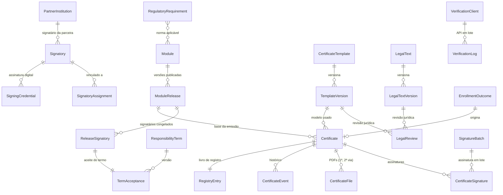
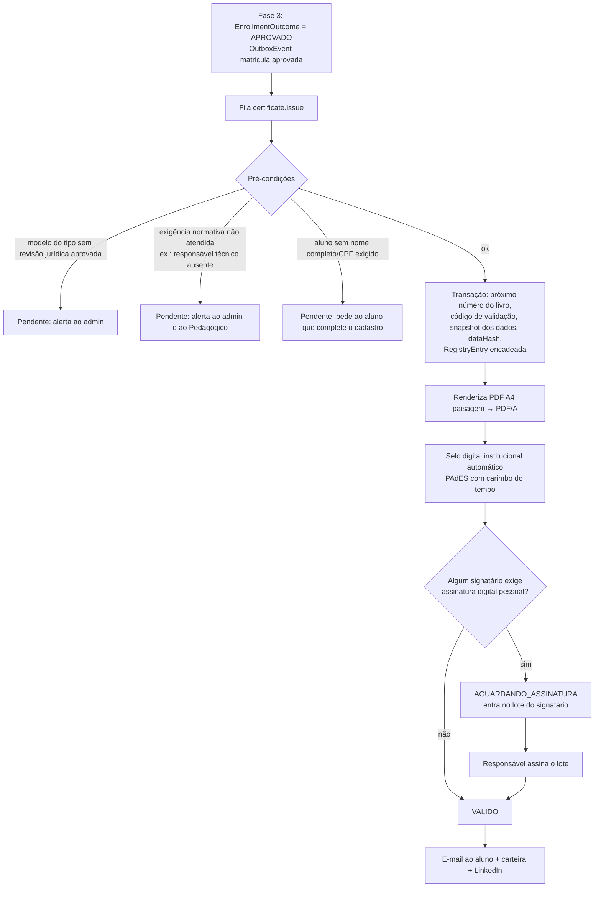
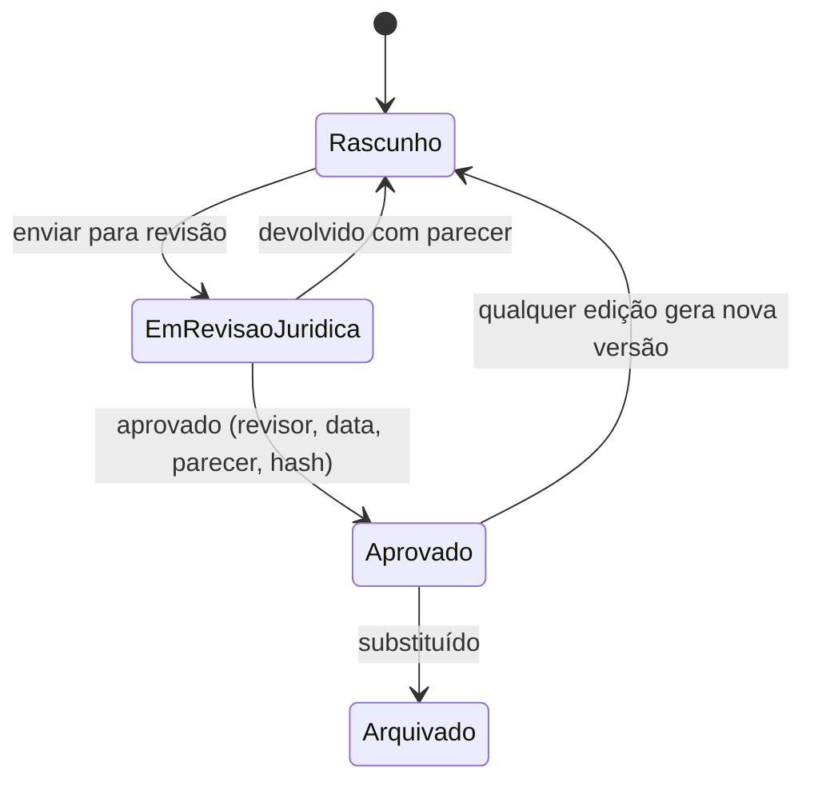

# Fase 4 — Certificação: modelo de dados, fluxo de assinatura e página de validação

> **Status:** proposta para aprovação. Nenhum código da Fase 4 foi escrito ainda.
> Complementa [`ARQUITETURA.md`](ARQUITETURA.md), [`FASE-2-BIBLIOTECA.md`](FASE-2-BIBLIOTECA.md) e [`FASE-3-AVALIACOES-FORUM.md`](FASE-3-AVALIACOES-FORUM.md). As decisões que pedem aprovação estão na [seção 9](#9-decisões-para-aprovação).
>
> ⚖️ Este documento descreve **como o sistema implementa** os requisitos legais. Ele não substitui parecer jurídico: os textos legais, os prazos de retenção e o enquadramento de cada tipo de curso devem ser validados por advogado(a) antes do uso em produção — e o próprio sistema impõe isso (seção 6.4).

## Sumário

1. [Princípios](#1-princípios)
2. [Modelo de dados](#2-modelo-de-dados)
3. [Responsáveis, vínculos e termo de responsabilidade](#3-responsáveis-vínculos-e-termo-de-responsabilidade)
4. [Modelos de certificado](#4-modelos-de-certificado)
5. [Emissão e fluxo de assinatura](#5-emissão-e-fluxo-de-assinatura)
6. [Conformidade legal](#6-conformidade-legal)
7. [Página pública de validação e API](#7-página-pública-de-validação-e-api)
8. [Notificações, carteira e compartilhamento](#8-notificações-carteira-e-compartilhamento)
9. [Decisões para aprovação](#9-decisões-para-aprovação)
10. [Testes e critérios de aceite](#10-testes-e-critérios-de-aceite)

---

## 1. Princípios

1. **Certificado emitido é um documento congelado.** No momento da emissão, todos os dados (aluno, módulo, carga horária, signatários, imagem das assinaturas, texto legal, modelo e cores do tema) são copiados para um *snapshot* imutável. Mudar depois o responsável do módulo, o modelo, o texto legal ou o tema **não altera** certificados já emitidos.
   > Esta é uma exceção deliberada à regra "mudar o tema muda todo o conteúdo publicado" das fases anteriores: um documento com valor de prova não pode mudar de aparência depois de emitido. Novos certificados usam o tema atual.
2. **Integridade verificável.** Cada certificado tem um *hash* SHA-256 dos dados canônicos, um selo digital da instituição no PDF e um registro em livro encadeado por hash, que torna qualquer adulteração detectável.
3. **Nada vai para produção sem aprovação registrada:** modelo sem revisão jurídica aprovada não emite; módulo sem termo de responsabilidade aceito não publica.
4. **Mínimo de dados pessoais em público:** a validação mostra só nome e CPF parcial.

---

## 2. Modelo de dados

### 2.1 Diagrama



### 2.2 Responsáveis e vínculos

| Entidade | Campos principais | Observações |
|---|---|---|
| `Signatory` | tenantId, userId (opcional), nomeCompleto, cpf (cifrado), cpfHash, qualificacao, titulacao, registros[] (`{conselho: CREA/CRC/CFA/OAB/CRM/CRMV/MAPA/…, numero, uf, validoAte}`), email, assinaturaImagemAssetId, metodoAssinatura (`IMAGEM`/`ICP_A1`/`ICP_A3_NUVEM`/`ICP_A3_TOKEN`/`PROVEDOR_ELETRONICO`), tipo (`PESSOA`/`INSTITUCIONAL`), partnerInstitutionId, status (`ATIVO`/`INATIVO`) | Pode ser alguém sem conta na plataforma (ex.: coordenador externo), que recebe acesso por convite apenas para aceitar termos e assinar. |
| `SigningCredential` | signatoryId, tipo (`ICP_A1`/`ICP_A3_NUVEM`/`PROVEDOR`), titularCertificado, emissor (AC), numeroSerie, validoDe/Ate, referencia (KMS/HSM ou ID no provedor), status | **A chave privada nunca fica no banco**: A1 em KMS/HSM; A3 no token do titular ou no provedor de nuvem. |
| `SignatoryAssignment` | signatoryId, escopo (`NIVEL`/`SEGMENTO`/`MODULO`), escopoId, papel (`AUTOR`/`COORDENADOR`/`INSTITUICAO`/`PARCEIRA`/`RESPONSAVEL_TECNICO`), ordem, obrigatorio, vigenteDe, vigenteAte | Vários signatários por módulo. Resolução: **Módulo > Segmento > Nível** (o mais específico vence, por papel). O signatário institucional costuma ficar no Nível ou no tenant. |
| `PartnerInstitution` | nome, cnpj, tipo (`IES`/`ESCOLA_TECNICA`/`ENTIDADE_CLASSE`/`OUTRA`), atoCredenciamento (ex.: portaria MEC, nº e data), seloAssetId, convenioStoredFileId, vigenciaDe/Ate, status | Parceria com instituição credenciada; só aparece no certificado durante a vigência do convênio. |

### 2.3 Termo de responsabilidade e versões do módulo

| Entidade | Campos principais | Observações |
|---|---|---|
| `ModuleRelease` (**nova**) | moduleId, numero, topicVersionIds[], cargaHorariaMin, conteudoProgramatico (lista de assuntos e cargas), regraAprovacao (snapshot da Fase 3), contentHash, publicadoEm | **Fotografia do módulo publicado.** Liga "qual conteúdo" a "quem se responsabilizou". Cada publicação do módulo gera um novo release. |
| `ResponsibilityTerm` | tenantId, versao, texto (blocos), publicadoEm | Texto do termo de responsabilidade pelo conteúdo. |
| `ReleaseSignatory` | moduleReleaseId, signatoryId, papel, ordem, snapshot (nome, qualificação, registros, imagem da assinatura — hash e asset congelados) | Os signatários resolvidos **no momento da publicação** e congelados para aquele release. |
| `TermAcceptance` | releaseSignatoryId, termVersion, contentHash aceito, aceitoEm, ip, userAgent, metodo (`CLIQUE_AUTENTICADO`/`ASSINATURA_DIGITAL`), evidenciaHash, autorizaAssinaturaEmLote | Registro de data, IP e versão do conteúdo aprovado. **Histórico de qual responsável assinou qual versão** = consulta a esta tabela. |

### 2.4 Modelos e textos legais

| Entidade | Campos principais | Observações |
|---|---|---|
| `CertificateTemplate` | tenantId, tipoCertificado (`CURSO`/`CAPACITACAO`/`TREINAMENTO`/`MENTORIA`/`AULA`), nome, currentVersionId | Um modelo ativo por tipo (podem existir outros em rascunho). |
| `TemplateVersion` | templateId, numero, layout (`CLASSICO`/`MODERNO`/`MINIMAL`), design (JSONB: tokens de cor permitidos, fontes do tema, logo, marca d'água, fundo, posição das zonas), frente, verso (opcional), status (`RASCUNHO`/`EM_REVISAO_JURIDICA`/`APROVADO`/`ARQUIVADO`), designHash | Qualquer edição gera nova versão e exige nova aprovação. |
| `LegalText` / `LegalTextVersion` | tipoCertificado, natureza (seção 6.1), texto, normasAplicaveis, status, hash | Texto legal editável por tipo, com versionamento. |
| `LegalReview` | alvo (`TemplateVersion` ou `LegalTextVersion`), alvoHash, revisorNome, revisorOab (opcional), decisao (`APROVADO`/`DEVOLVIDO`), parecer, decididoEm, revisorUserId | **Fluxo de revisão jurídica.** A aprovação vale para o hash revisado; mudou o conteúdo, perde a validade. |
| `RegulatoryRequirement` | codigo (`NR-10`, `NR-35`, `CFC-EPC`…), descricao, exigeInstrutorHabilitado, exigeResponsavelTecnico (`{conselho}`), exigeInstituicaoCredenciada, cargaMinimaHoras, exigePraticaPresencial, camposObrigatorios[], validadeMeses (reciclagem), fonteNormativa, revisadoEm | Catálogo de exigências, mantido pelo admin/jurídico. Vinculado a módulos. |

### 2.5 Certificados e registro

| Entidade | Campos principais | Observações |
|---|---|---|
| `Certificate` | tenantId, numeroRegistro (`2026.000123`), codigoValidacao (`K7QM-4XPA-9TRB`), enrollmentOutcomeId, moduleReleaseId, templateVersionId, legalTextVersionId, status (`EM_EMISSAO`/`AGUARDANDO_ASSINATURA`/`VALIDO`/`REVOGADO`), modoEmissao (`AUTOMATICA`/`MANUAL`), justificativaManual, autorizadoPorId, dados (JSONB canônico — abaixo), dataHash, emitidoEm, validoAte (quando há reciclagem), revogadoEm, revogadoPorId, motivoRevogacao, categoriaRevogacao | `numeroRegistro` é **sequencial** (controle interno, livro); `codigoValidacao` é **aleatório** (60 bits, sem caracteres ambíguos) e é o que vai no QR Code, para impedir que alguém percorra a numeração. |
| `Certificate.dados` | aluno `{nome, cpfParcial}`, curso `{titulo, nivel, segmento, natureza, cargaHoraria, periodo, nota, frequencia, conteudoProgramatico[]}`, signatarios[] (snapshot), instituicao, parceira, textoLegal, normas[], temaSnapshot (valores dos tokens), emitidoEm | Fonte única do PDF e da página de validação. O `dataHash` é calculado sobre a serialização canônica (JSON ordenado) desses dados. |
| `CertificateSignature` | certificateId, signatoryId, papel, metodo, status (`PENDENTE`/`ASSINADA`/`FALHOU`), assinadoEm, batchId, detalhes (AC, número de série, carimbo do tempo) | Uma por signatário. |
| `SignatureBatch` | signatoryId, certificados[], status, iniciadoEm, concluidoEm, metodo | Assinatura em lote pelo responsável (A3/provedor). |
| `CertificateFile` | certificateId, via (1, 2, 3…), storedFileId, pdfHash, geradoEm, motivo (`EMISSAO`/`SEGUNDA_VIA`/`REASSINATURA`) | **2ª via mantém o mesmo número e o mesmo `dataHash`**; só o arquivo é novo, com a menção "2ª via emitida em …". |
| `CertificateEvent` | certificateId, tipo (`EMITIDO`/`ASSINADO`/`ENVIADO`/`BAIXADO`/`SEGUNDA_VIA`/`REVOGADO`/`REVOGACAO_ANULADA`/`VALIDADO`), atorId, dados, criadoEm | Histórico completo, somente inserção. |
| `RegistryEntry` | tenantId, livro (ano), sequencia, certificateId, dataHash, previousHash, entryHash, registradoEm | **Livro de registro** encadeado por hash (cada entrada contém o hash da anterior). A numeração é sem lacunas (contador por tenant/ano bloqueado na transação). Exportável em PDF/CSV por período. |
| `RegistryCounter` | tenantId, ano, ultimo | Garante sequência sem buracos (uma sequence do PostgreSQL pode pular números). |
| `VerificationClient` | tenantId, empresa, cnpj, apiKeyHash, escopos, limitePorMinuto, status | Empresas que usam a API de validação em lote. |
| `VerificationLog` | clienteId ou ip, codigo, resultado, criadoEm | Auditoria e detecção de abuso. |

---

## 3. Responsáveis, vínculos e termo de responsabilidade

### 3.1 Vínculos

- No cadastro do Módulo, aba **Signatários**: mostra os signatários herdados do Segmento e do Nível e permite adicionar ou substituir por papel (Autor, Coordenador, Responsável Técnico, Instituição, Parceira), definir a ordem de exibição e quem é obrigatório.
- Validações: registro profissional exigido pela norma do módulo (ex.: NR que pede responsável técnico com CREA) precisa estar preenchido e vigente; signatário inativo não pode ser vinculado; parceira com convênio vencido gera alerta.

### 3.2 Publicação com termo de responsabilidade

```mermaid
sequenceDiagram
  autonumber
  participant P as Autor/Pedagógico
  participant S as Plataforma
  participant R as Responsável(eis)
  P->>S: Solicita publicação do módulo
  S->>S: Gera ModuleRelease (conteúdo + contentHash)<br/>resolve e congela signatários (ReleaseSignatory)
  S->>R: E-mail "Termo de responsabilidade pendente"
  R->>S: Abre o termo: vê o conteúdo programático, carga horária<br/>e o resumo das alterações desde o último release
  R->>S: Aceita (login + 2FA, ou assinatura digital)<br/>opção: autorizar assinatura dos certificados deste release
  S->>S: TermAcceptance (data, IP, user agent, versão do termo, contentHash)
  alt todos os obrigatórios aceitaram
    S->>P: Módulo publicado
  else algum recusou ou não respondeu
    S->>P: Publicação pendente (lembretes automáticos; recusa com motivo)
  end
```

- Uma correção no conteúdo depois de publicado gera um **novo release**, que exige novo aceite. As matrículas em andamento seguem no release em que estão até a conclusão. Os certificados citam o release que o aluno cursou.
- **Trocar o responsável** de um módulo afeta somente os **próximos** releases. Os certificados já emitidos e os releases anteriores mantêm os signatários congelados.

---

## 4. Modelos de certificado

### 4.1 Editor (no tema da plataforma)

- Em vez de uma tela de desenho livre, o editor trabalha com **3 layouts estruturados** (Clássico, Moderno, Minimal) em A4 paisagem, com **zonas configuráveis**: cabeçalho (logo, nome da instituição, selo da parceira), título, corpo, dados, signatários, rodapé (número, QR Code, texto legal) e verso. Isso evita sobreposições e garante legibilidade com qualquer nome ou título.
- Configurações: cores (a partir dos tokens do tema, com validação de contraste), fontes (as famílias do tema), logotipo, **marca d'água**, **fundo** (imagem ou textura com opacidade controlada), molduras e filetes em dourado `--color-accent`.
- **Campos dinâmicos** inseridos por menu: `{{aluno.nome}}`, `{{aluno.cpfParcial}}`, `{{curso.titulo}}`, `{{curso.nivel}}`, `{{curso.segmento}}`, `{{curso.natureza}}`, `{{curso.cargaHoraria}}`, `{{curso.periodo}}`, `{{curso.nota}}`, `{{curso.frequencia}}`, `{{emissao.data}}`, `{{registro.numero}}`, `{{registro.codigo}}`, `{{qrcode}}`, `{{signatarios}}`, `{{textoLegal}}`, `{{normas}}`, `{{validoAte}}`.
- **Ajuste automático** de nomes e títulos longos (redução de corpo dentro de limites, depois quebra de linha).
- **Verso opcional:** conteúdo programático gerado do `ModuleRelease` (assuntos com carga horária), normas atendidas, local e modalidade.
- **Pré-visualização** com dados de exemplo e com casos extremos (nome de 80 caracteres, 4 signatários, curso com 40 assuntos).

### 4.2 Um modelo por tipo

| Tipo | Documento | Campos típicos |
|---|---|---|
| Curso | **Certificado** de conclusão | nota, carga horária, período, conteúdo programático |
| Capacitação | **Certificado** de capacitação | nota, **frequência**, carga horária, normas (NR), validade |
| Treinamento | **Certificado** de treinamento | carga horária, empresa/equipe, normas, validade |
| Mentoria | **Declaração de participação** | período, número de encontros, horas |
| Aula | **Declaração de participação** | data, duração |

### 4.3 Geração do PDF

- O modelo é renderizado como HTML/CSS com os **valores congelados dos tokens** e impresso em PDF pelo **Chromium headless** (Playwright, já presente no projeto). O resultado tem texto vetorial (nítido em qualquer zoom e selecionável), fontes embutidas e imagens em alta resolução, em **A4 paisagem**, com frente e verso.
- Conversão para **PDF/A-2b** (arquivamento de longo prazo) antes da assinatura.
- O PDF contém metadados (número, código, hash) e o QR Code em vetor.

---

## 5. Emissão e fluxo de assinatura

### 5.1 Emissão automática



A emissão é **idempotente**: se o evento chegar duas vezes, o certificado não é duplicado (há uma chave única por `enrollmentOutcomeId`).

### 5.2 Emissão manual

Disponível só para quem tem a permissão `certificate:issue_manual` (Admin). Exige **justificativa** e registra quem autorizou. Casos típicos: migração de alunos de outra plataforma, aprovação decidida em conselho. O certificado traz o mesmo layout, e no histórico (não no documento) fica `modoEmissao = MANUAL`. Ação auditada, com notificação ao Responsável Pedagógico.

### 5.3 Os três níveis de assinatura

| Camada | O que é | Quando | Como |
|---|---|---|---|
| **1. Assinatura visual** | Imagem da assinatura de cada signatário, impressa no certificado | Sempre | A imagem congelada no `ReleaseSignatory`. Por si só **não tem valor de assinatura digital**: representa a autorização dada pelo responsável no termo (seção 3.2). |
| **2. Selo digital institucional** | Assinatura digital PAdES com o **e-CNPJ A1 (ICP-Brasil) da instituição**, com carimbo do tempo | Sempre, automática | Chave em KMS/HSM; assinatura feita pelo serviço de assinatura (abaixo). Garante integridade e autoria institucional: qualquer alteração no PDF invalida o selo, verificável no Adobe Reader e no Verificador do ITI. |
| **3. Assinatura digital pessoal** (opcional por signatário) | Assinatura do responsável com o **próprio certificado ICP-Brasil** ou por **provedor de assinatura eletrônica** | Quando configurada no signatário | Em lote (abaixo). |

**Assinatura pessoal em lote:**

- **ICP-Brasil A3 em nuvem** (BirdID, VIDaaS, SafeID, NeoID e similares): o responsável autoriza no aplicativo do celular **uma sessão de assinatura** e o lote inteiro é assinado. É a opção recomendada para quem precisa de assinatura qualificada sem token físico.
- **ICP-Brasil A3 em token/cartão:** o responsável assina o lote pelo navegador, com um componente de assinatura local (ex.: Web PKI). Funciona, mas exige o token conectado.
- **ICP-Brasil A1 do próprio responsável:** pode ficar custodiado em KMS com autorização expressa registrada no termo. Assinatura automática, mas com custódia da chave pessoal pela plataforma, o que é delicado (D3).
- **Provedor de assinatura eletrônica** (Clicksign, D4Sign, ZapSign e similares): assinatura eletrônica avançada por envelope em lote; custo por documento.

O signatário recebe um e-mail **"Certificados aguardando sua assinatura"** (agrupado, no máximo um por dia) com acesso a uma tela de lote: lista, pré-visualização por amostragem e botão "Assinar N certificados". Com SLA configurável (padrão 5 dias úteis), há lembrete ao signatário e alerta ao admin. Enquanto isso, o aluno vê "Certificado em emissão — aguardando assinatura do responsável".

### 5.4 Serviço de assinatura

- **pyHanko** (Python, licença MIT), no container Python já previsto na Fase 2 (serviço `extrator`). Ele dá suporte completo a **PAdES** (B-B, B-T com carimbo do tempo e B-LT com informações de revogação embutidas, que mantém a assinatura verificável depois que o certificado do signatário expirar), a múltiplas assinaturas no mesmo PDF e a HSM/PKCS#11. As bibliotecas em Node.js para PAdES são bem menos maduras, principalmente em carimbo do tempo e LTV.
- **Carimbo do tempo:** de uma Autoridade de Carimbo do Tempo (ACT) credenciada na ICP-Brasil (recomendado) ou de uma TSA pública (mais barata, sem valor ICP).

### 5.5 Segunda via, revogação e histórico

| Operação | Regras |
|---|---|
| **2ª via** | Mesmo **número de registro**, mesmo **código de validação** e mesmo **`dataHash`** (os dados não mudam). Gera um novo PDF a partir do snapshot original (modelo, tema e signatários congelados), com a menção "2ª via emitida em dd/mm/aaaa" e novo selo institucional. Disponível ao aluno (download ilimitado do arquivo original) e ao admin (reemissão). |
| **Correção de dado** (ex.: nome digitado errado) | Não se edita um certificado emitido: **revoga-se com o motivo "Substituído por correção"** e emite-se um novo, com novo número, referenciando o anterior. A validação do antigo mostra "Revogado — substituído pelo certificado nº …". |
| **Revogação** | Admin (ou Pedagógico, se permitido), com **categoria** (`ERRO_EMISSAO`, `FRAUDE`, `DECISAO_ACADEMICA`, `SUBSTITUIDO`, `SOLICITACAO_DO_TITULAR`, `OUTRO`) e **motivo detalhado** (interno). A página pública mostra só a categoria e a data. Notifica o aluno e o admin. |
| **Anular revogação** | Só Admin, com justificativa (para revogação feita por engano). Fica no histórico. |
| **Histórico** | `CertificateEvent` com todas as operações; tela de linha do tempo para admin e aluno. |

---

## 6. Conformidade legal

### 6.1 Natureza do curso e texto legal

O campo `natureza` do módulo determina o texto legal impresso no certificado e exibido na validação. As opções, com **minutas a serem revisadas pelo jurídico**:

| Natureza | Quando usar | Minuta do texto legal |
|---|---|---|
| **Curso livre** | Padrão para cursos, aulas e mentorias | "Curso livre, oferecido na modalidade a distância, não sujeito a autorização, reconhecimento ou regulamentação pelo Ministério da Educação, nos termos da Lei nº 9.394/1996. Este certificado não equivale a diploma de curso de educação formal." |
| **Formação continuada / capacitação profissional** | Capacitações e treinamentos de atualização profissional | "Curso livre de formação continuada / capacitação profissional, com carga horária de {{carga}} horas. Não confere habilitação profissional nem equivale a diploma de curso técnico ou superior." |
| **Extensão** | **Somente quando emitido em parceria com Instituição de Ensino Superior credenciada** que reconheça a atividade como extensão | "Curso de extensão promovido em parceria com {{parceira}}, credenciada pelo {{ato}}." |
| **Treinamento normativo** | Treinamentos regulamentados (ex.: NRs) | Texto livre revisado pelo jurídico, citando a norma e os requisitos atendidos (carga horária, conteúdo, instrutor/responsável técnico, validade). |

> **Atenção ao termo "extensão":** no ensino superior, "curso de extensão" é uma atividade de Instituição de Ensino Superior. Usá-lo sem uma IES parceira pode induzir à ideia de vínculo com educação formal — exatamente o que o pedido quer evitar. Por isso o sistema **só libera a natureza "Extensão" quando há parceria vigente com uma IES** (D6).
>
> **Referências legais:** recomendo que o jurídico confirme a vigência e a redação atual do **Decreto 5.154/2004** (educação profissional), citado no pedido, antes de citá-lo em texto impresso, pois a regulamentação da educação profissional sofreu alterações posteriores. Por precaução, as minutas acima citam apenas a LDB.

### 6.2 Normas específicas e alertas

- O admin vincula ao módulo as exigências do catálogo `RegulatoryRequirement` (ex.: uma NR, a educação profissional continuada de um conselho).
- O sistema **alerta** (no cadastro do módulo, na publicação e na emissão) quando a norma exige algo não atendido: carga horária abaixo do mínimo, falta de responsável técnico com o registro exigido, falta de instrutor habilitado, falta de atividade prática presencial registrada ou falta de instituição credenciada.
- Pela configuração do tenant, cada alerta pode ser **impeditivo** (bloqueia publicação/emissão) ou **informativo**. Padrão proposto: impeditivo para carga horária e responsável técnico, informativo para os demais (D7).
- Certificados com `validadeMeses` (reciclagem) exibem "Válido até" e geram um aviso de reciclagem ao aluno e ao gestor 60 dias antes do vencimento.
- O catálogo vem **vazio por padrão**, para ser preenchido pelo jurídico/SST de vocês. Normas mudam, e a plataforma não deve presumir requisitos; cada item guarda a fonte normativa e a data da última revisão.

### 6.3 Parceria com instituição credenciada

Com convênio vigente, o certificado exibe o **selo** e o **signatário da parceira**, e a validação mostra o nome da instituição e o ato de credenciamento informado. Com o convênio vencido, novos certificados deixam de usar a parceria e o admin é alertado (os já emitidos permanecem como foram emitidos).

### 6.4 Fluxo de revisão jurídica



- Um perfil **Revisor jurídico** (novo papel, opcional; pode ser um advogado externo com acesso só a esta tela) aprova ou devolve modelos e textos legais.
- **Produção só usa modelo e texto legal com aprovação registrada** para o hash exato da versão. Em pré-visualização, versões não aprovadas saem com a marca d'água "MODELO NÃO APROVADO — SEM VALIDADE".

### 6.5 Retenção e LGPD

| Dado | Base legal (LGPD, art. 7º) | Retenção proposta |
|---|---|---|
| **Registro mínimo de emissão** (nome, CPF parcial + hash do CPF, curso, carga horária, período, data, número, código, signatários, hash) | Execução de contrato (V) e exercício regular de direitos (VI) — o titular e terceiros precisam poder validar o documento | Por prazo indeterminado enquanto o certificado puder ser apresentado — **prazo a definir com o jurídico** |
| PDFs emitidos | Idem | Idem (podem ser regerados a partir do snapshot) |
| Termos de responsabilidade e revisões jurídicas | Cumprimento de obrigação legal/regulatória (II) e exercício de direitos (VI) | Mínimo de 5 anos após o fim da oferta do módulo |
| Logs de validação | Legítimo interesse (IX) — segurança e prevenção de abuso | 6 meses |

- **Exportação de dados** do titular inclui todos os certificados (PDF e dados).
- **Pedido de exclusão:** os dados não essenciais da conta são apagados ou anonimizados, e o **registro mínimo de emissão é preservado**, com a explicação ao titular da base legal. O titular pode pedir a **revogação** do próprio certificado (categoria `SOLICITACAO_DO_TITULAR`); nesse caso a validação passa a mostrar só "Revogado a pedido do titular", sem nome.
- CPF completo só no cadastro (cifrado); no certificado e na validação, apenas o CPF parcial (`***.456.789-**`).

---

## 7. Página pública de validação e API

### 7.1 Rotas

| Rota | Função |
|---|---|
| `/validar` | Página inicial: campo para digitar o código (com máscara `XXXX-XXXX-XXXX`), leitura de QR pela câmera do celular e **verificação de arquivo** (arrastar o PDF recebido: a página confere se o arquivo é íntegro e corresponde a um certificado emitido) |
| `/validar/{codigo}` | Resultado da validação (destino do QR Code) |
| `/api/v1/public/certificates/{codigo}` | Consulta unitária (JSON) |
| `/api/v1/verify/batch` | API em lote para empresas (autenticada) |

### 7.2 Estrutura de `/validar/{codigo}`

Página no tema da plataforma, sem login, com `noindex` (não indexada por buscadores) e otimizada para celular (é aberta pelo QR):

```
┌───────────────────────────────────────────────────────────────┐
│ [Logo da instituição]                     Validação de certificado │
├───────────────────────────────────────────────────────────────┤
│ ✅ CERTIFICADO VÁLIDO                                            │
│ Emitido em 14/10/2026 · Registro nº 2026.000123                  │
│ (ou ⛔ CERTIFICADO REVOGADO em 20/10/2026 — Erro de emissão;     │
│  ou ⏳ EM EMISSÃO; ou ⚠️ VENCIDO em … — exige reciclagem)         │
├───────────────────────────────────────────────────────────────┤
│ Titular          Maria A. da Silva                               │
│ CPF              ***.456.789-**                                  │
│ Curso            Gestão Financeira para o Agronegócio            │
│ Tipo/Natureza    Capacitação · Curso livre de formação continuada│
│ Nível/Segmento   Capacitações › Agronegócio                      │
│ Carga horária    40 horas                                        │
│ Período          01/08/2026 a 30/09/2026                         │
│ Válido até       (quando houver reciclagem)                      │
├───────────────────────────────────────────────────────────────┤
│ Signatários                                                      │
│  • João P. Souza — Engenheiro Agrônomo — CREA-SP 123456 (Autor)  │
│  • Ana R. Lima — Coordenadora Pedagógica (Coordenação)           │
│  • Instituição Exemplo Ltda. — CNPJ 00.000.000/0001-00           │
│  • [selo] Parceira X — Portaria MEC nº … (quando houver)         │
├───────────────────────────────────────────────────────────────┤
│ Texto legal: "Curso livre, … não equivale a diploma …"           │
├───────────────────────────────────────────────────────────────┤
│ Integridade                                                      │
│  Código: K7QM-4XPA-9TRB · Hash: 9f2c…a71b (SHA-256)              │
│  Selo digital: ICP-Brasil · Instituição Exemplo · carimbo do tempo│
│  [Verificar o PDF que recebi]                                    │
└───────────────────────────────────────────────────────────────┘
```

Não são exibidos nota, frequência, e-mail nem dados de contato do aluno (minimização — D8). O conteúdo programático completo fica no verso do PDF.

### 7.3 Proteção contra abuso

- O **código de validação é aleatório** (60 bits): adivinhar códigos válidos é inviável, e a numeração sequencial do livro nunca é usada como chave pública.
- **Limite de consultas** por IP (ex.: 30 por minuto e 300 por dia) no Redis; acima disso, **desafio anti-robô** (ex.: Cloudflare Turnstile, sem coleta de dados para publicidade) e, persistindo, bloqueio temporário.
- Respostas idênticas para "código inexistente" e "formato inválido" (não revelam padrões); registro em `VerificationLog`; alerta ao admin para picos anômalos.

### 7.4 API em lote para empresas

```http
POST /api/v1/verify/batch
Authorization: Bearer <chave da empresa>
Content-Type: application/json

{ "itens": [
  { "codigo": "K7QM-4XPA-9TRB", "cpf": "123.456.789-09" },
  { "codigo": "P3XD-8LWN-2MCF" }
] }
```

```json
{ "resultados": [
  { "codigo": "K7QM-4XPA-9TRB", "situacao": "VALIDO", "cpfConfere": true,
    "titular": "Maria A. da Silva", "curso": "Gestão Financeira para o Agronegócio",
    "cargaHoraria": 40, "emitidoEm": "2026-10-14", "validoAte": null },
  { "codigo": "P3XD-8LWN-2MCF", "situacao": "NAO_ENCONTRADO" }
] }
```

- Até 100 itens por chamada; chave de API por empresa, cadastrada pelo admin (`VerificationClient`), com limite de taxa próprio.
- O CPF enviado pela empresa (que já o possui, por exemplo de um candidato) só é **comparado** com o hash armazenado e a resposta é apenas `cpfConfere: true/false`. **A API nunca devolve CPF.**
- Todas as consultas são registradas; a empresa aceita termos de uso da API (finalidade de verificação).

---

## 8. Notificações, carteira e compartilhamento

| Evento | Destinatário | Canal |
|---|---|---|
| Certificado emitido | Aluno | E-mail com link para baixar (e PDF anexo, configurável) + notificação no app |
| Termo de responsabilidade pendente | Responsável | E-mail + lembretes (2, 5 e 10 dias) |
| Certificados aguardando assinatura | Responsável | E-mail diário agrupado enquanto houver pendência |
| Emissão bloqueada (modelo sem revisão jurídica, norma não atendida) | Admin e Pedagógico | E-mail + painel |
| Revogação | Admin (sempre) e aluno | E-mail |
| Reciclagem próxima do vencimento | Aluno e gestor (Treinamentos) | E-mail 60 dias antes |

**Carteira de certificados** (aba Certificados do aluno): cartões no tema com situação, download do PDF, link de validação, copiar código e histórico. **LinkedIn:** botão "Adicionar ao perfil", que preenche nome do curso, instituição, mês/ano de emissão, código e URL de validação pela URL oficial de "adicionar certificação" do LinkedIn, e botão "Compartilhar publicação", com o link de validação.

---

## 9. Decisões para aprovação

| # | Decisão | Recomendação |
|---|---|---|
| D1 | Certificado emitido **congelado** (tema, modelo, signatários e texto legal não mudam depois da emissão), como exceção à regra global de tema | ✅ |
| D2 | Selo digital **institucional automático** (e-CNPJ A1 ICP-Brasil + carimbo do tempo) em todos os certificados | ✅ Exige que a instituição tenha um e-CNPJ A1 |
| D3 | Assinatura pessoal do responsável: **A3 em nuvem em lote** (recomendado), token A3, provedor eletrônico, ou A1 custodiado | A3 em nuvem; evitar custodiar A1 pessoal |
| D4 | Número de registro **sequencial por ano** (`2026.000123`) + **código aleatório** para validação/QR | ✅ |
| D5 | Correção de dados = revogar e emitir substituto (nunca editar emitido) | ✅ |
| D6 | Natureza **"Extensão" só com parceria vigente com IES** | ✅ |
| D7 | Alertas normativos impeditivos para carga horária e responsável técnico; informativos para o resto | Ajustável pelo jurídico |
| D8 | Validação pública **sem nota e frequência** (só nome, CPF parcial, curso, carga horária, período, data, signatários, situação) | ✅ Minimização (LGPD) |
| D9 | Novo papel **Revisor jurídico** (pode ser externo) | ✅ |
| D10 | Prazo de retenção do registro mínimo de emissão | Definir com o jurídico (proposta: indeterminado enquanto o certificado puder ser apresentado) |
| D11 | Mudança no conteúdo do módulo publicado gera **novo release com novo aceite** do responsável | ✅ |
| D12 | Serviço de assinatura com **pyHanko** no container Python da Fase 2 | ✅ |

---

## 10. Testes e critérios de aceite

### Testes automatizados

| Camada | O que cobre |
|---|---|
| Unitário | Resolução de signatários (Módulo > Segmento > Nível por papel); serialização canônica e `dataHash`; geração do código (sem ambíguos, entropia); encadeamento do livro de registro; regras de natureza (Extensão sem IES é recusada); alertas normativos |
| Concorrência | 100 emissões simultâneas → números sequenciais sem lacunas nem duplicados; evento duplicado não gera dois certificados |
| PDF | Renderização com casos extremos (nome longo, 4 signatários, 40 assuntos no verso); PDF/A válido (veraPDF); selo PAdES válido; alterar 1 byte invalida o selo |
| Imutabilidade | Trocar o responsável, o modelo, o texto legal e o tema **depois** da emissão → PDF da 2ª via e página de validação continuam com os dados originais |
| Validação | Válido, revogado, em emissão, vencido, inexistente; limite de consultas; API em lote com CPF que confere e que não confere (sem vazar CPF) |
| E2E (Playwright) | Fluxos dos critérios de aceite, no celular e no desktop |
| Acessibilidade | axe-core na validação, na carteira, no editor de modelos e na tela de lote de assinatura |

### Critérios de aceite da Fase 4

- [ ] Aluno aprovado recebe o **certificado em PDF no tema**, com a assinatura do **responsável do módulo** e do **signatário institucional** (e o selo digital).
- [ ] O **QR Code** abre a página pública e confirma a autenticidade.
- [ ] Um certificado **revogado** aparece como revogado na validação.
- [ ] **Mudar o responsável** de um módulo **não altera** certificados já emitidos.
- [ ] O **texto legal** exibido corresponde ao **tipo/natureza** de curso configurado.
- [ ] Módulo não publica sem o termo de responsabilidade aceito (com data, IP e versão registrados).
- [ ] Modelo sem revisão jurídica aprovada não emite em produção.
- [ ] 2ª via mantém número e código; o livro de registro exportado confere com o encadeamento de hash.
