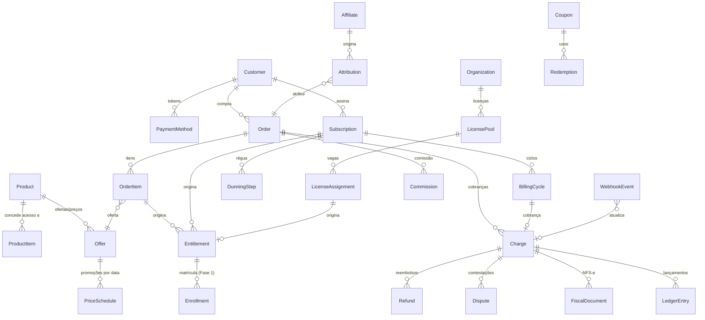
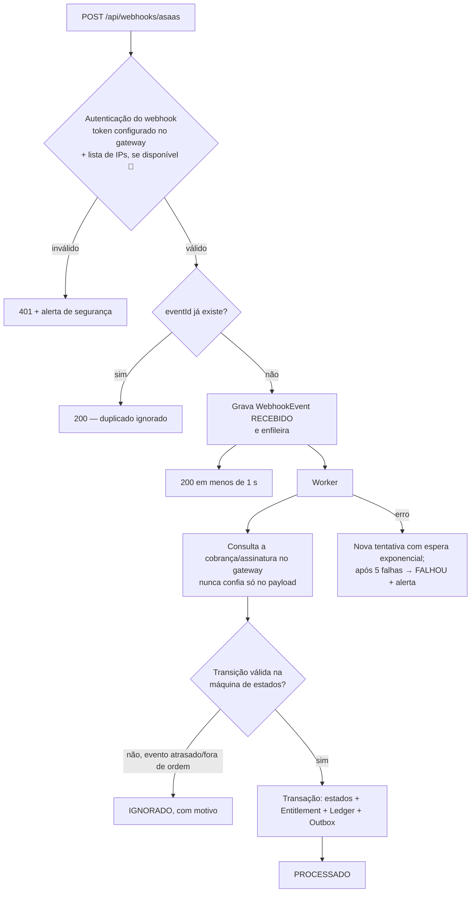
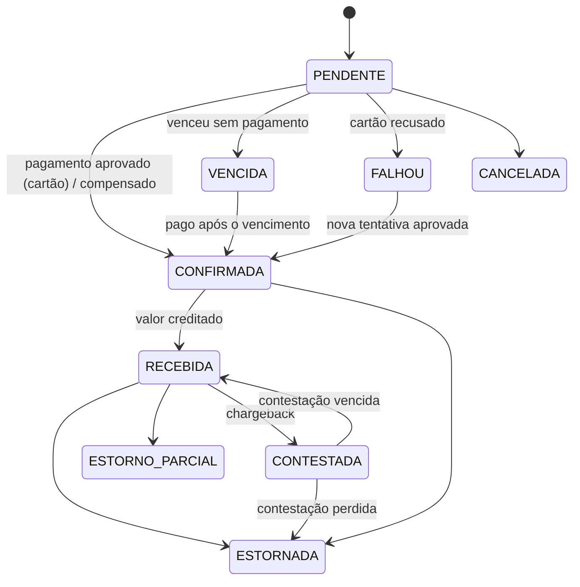
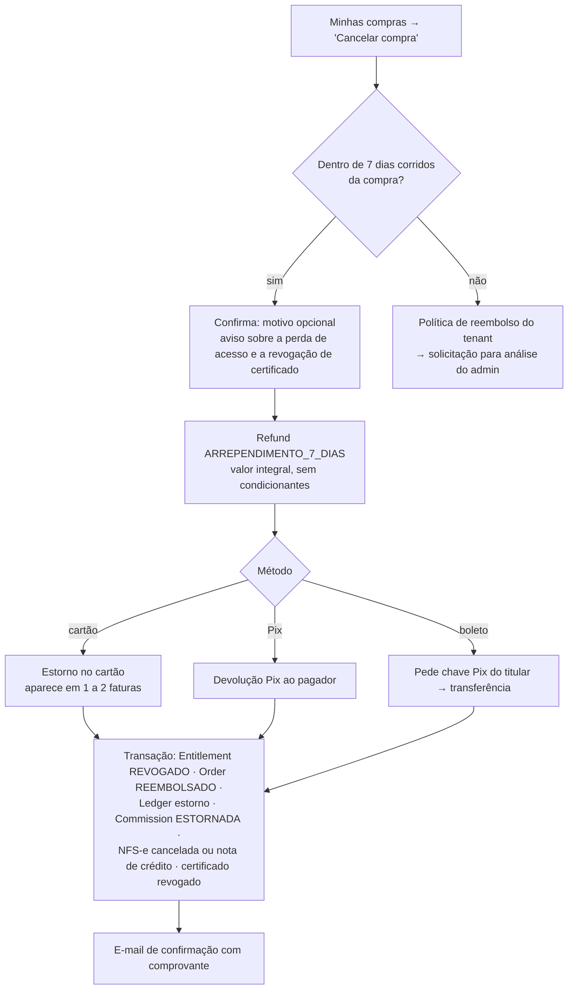

# Fase 5 — Camada comercial e painel de gestão: modelo financeiro, fluxo de pagamento/webhook e régua de inadimplência

> **Status:** proposta comercial ampla; o primeiro escopo de matrícula avulsa por Pix/Asaas está implementado no app, com gestão de cobranças, baixa manual e preços em **Financeiro** e gestão de matrículas em **Matrículas**; o B2B da seção 7.1 (Organization, OrganizationMember, LicensePool, LicenseAssignment, painel do gestor e relatório por equipe) está implementado como **Enterprise**, ainda sem checkout B2B automático nem NFS-e (ver [DEPLOY.md](DEPLOY.md)). Assinaturas, reembolsos, cupons, cartões, boletos e razão financeiro ainda não estão implementados.
> Complementa [`ARQUITETURA.md`](ARQUITETURA.md) e os documentos das Fases 2 a 4. As decisões que pedem aprovação estão na [seção 11](#11-decisões-para-aprovação).
>
> Tarifas, recursos e regras de gateways, de NFS-e e do WhatsApp mudam com frequência. Os itens marcados com 🔎 devem ser confirmados na documentação e no contrato vigentes durante a integração.

## Sumário

1. [Princípios](#1-princípios)
2. [Escolha do gateway](#2-escolha-do-gateway)
3. [Modelo de dados financeiro](#3-modelo-de-dados-financeiro)
4. [Fluxo de pagamento e webhooks](#4-fluxo-de-pagamento-e-webhooks)
5. [Assinaturas e régua de inadimplência](#5-assinaturas-e-régua-de-inadimplência)
6. [Reembolso e direito de arrependimento](#6-reembolso-e-direito-de-arrependimento)
7. [B2B, mentorias, afiliados e nota fiscal](#7-b2b-mentorias-afiliados-e-nota-fiscal)
8. [Catálogo, páginas de venda e funil](#8-catálogo-páginas-de-venda-e-funil)
9. [Painéis, definições de métricas e painel administrativo](#9-painéis-definições-de-métricas-e-painel-administrativo)
10. [Segurança, LGPD e operação](#10-segurança-lgpd-e-operação)
11. [Decisões para aprovação](#11-decisões-para-aprovação)
12. [Testes em sandbox e critérios de aceite](#12-testes-em-sandbox-e-critérios-de-aceite)
13. [Checklist de go-live](#13-checklist-de-go-live)

---

## 1. Princípios

1. **Acesso vem de um direito, não de um pagamento.** Toda liberação passa por uma entidade única, `Entitlement` (direito de acesso), que pode nascer de compra avulsa, assinatura, licença B2B, cortesia ou matrícula manual. Pagar, atrasar, regularizar, reembolsar e cancelar apenas **mudam o estado do direito**, e o conteúdo consulta só ele.
2. **O gateway é a fonte da verdade do dinheiro; o webhook é só um aviso.** Ao receber um webhook, a plataforma **consulta o gateway** para confirmar o estado real antes de agir. Uma reconciliação periódica cobre webhooks perdidos.
3. **Idempotência em tudo.** Cada evento externo é processado exatamente uma vez (chave única); as transições de estado são monotônicas (um pagamento confirmado não "volta" para pendente por um evento atrasado).
4. **Dados de cartão nunca passam pelos nossos servidores.** O número do cartão vai do navegador direto para o gateway (tokenização no navegador ou checkout hospedado). Guardamos só token, bandeira, 4 últimos dígitos e validade.
5. **Dinheiro em centavos (`Int`), em BRL, com razão contábil própria** (`LedgerEntry`, somente inserção) para relatórios e conciliação. Os painéis leem da razão, não de somas soltas de pedidos.
6. **Uma camada de abstração** `PaymentProvider` isola o gateway: o resto do sistema não conhece Asaas/Pagar.me/Stripe. Há também um `FakeProvider` para testes determinísticos.

---

## 2. Escolha do gateway

| Critério | **Asaas** | Pagar.me | Stripe |
|---|---|---|---|
| Pix, boleto, cartão | ✅ | ✅ | ✅ (Pix e boleto no Brasil) |
| Assinatura recorrente nativa | ✅ (cartão, boleto e Pix) | ✅ | ✅ (forte em cartão) |
| Parcelamento no cartão | ✅ | ✅ | ✅ |
| **Emissão de NFS-e integrada** | ✅ (conforme o município 🔎) | ❌ (precisa de emissor à parte) | ❌ (precisa de emissor à parte) |
| Régua de cobrança própria (e-mail/SMS/WhatsApp) | ✅ (opcional, paga 🔎) | parcial | parcial (e-mails) |
| **Split de pagamento** (repasse a afiliados/parceiros) | ✅ | ✅ (muito forte) | ✅ (Connect) |
| Sandbox | ✅ | ✅ | ✅ (com "relógio de teste" para recorrência) |
| Tokenização de cartão no navegador | 🔎 confirmar; alternativa: checkout hospedado | ✅ (tokenização com chave pública) | ✅ (Elements) |
| Perfil | Pequenas e médias empresas brasileiras, foco em cobrança | Médias/grandes, marketplaces | Global, melhor API e DX |

**Recomendação: Asaas** como gateway principal. É o único dos três que reúne, num só contrato e numa só integração, os cinco pilares pedidos: Pix, cartão com recorrência e parcelamento, boleto, **NFS-e** e **split** para afiliados. Isso reduz o número de fornecedores, de conciliações e de pontos de falha. A camada `PaymentProvider` mantém a troca possível.

**Ressalva importante (D2):** o Princípio 4 exige que o número do cartão não passe pelo nosso servidor. Se, na integração, a tokenização do Asaas exigir que os dados do cartão trafeguem pelo nosso backend, usaremos o **checkout/fatura hospedado do Asaas** para pagamentos com cartão, ou o Pagar.me apenas para cartão. Do contrário, a plataforma entraria no escopo completo do PCI DSS, o que é desproporcional.

---

## 3. Modelo de dados financeiro

Convenções das fases anteriores (UUID v7, `tenantId` + RLS, auditoria). Valores em centavos.

### 3.1 Diagrama



### 3.2 Catálogo e preços

| Entidade | Campos principais | Observações |
|---|---|---|
| `Product` | tipo (`MENTORIA`/`TREINAMENTO`/`CURSO`/`AULA`/`CAPACITACAO`/`PACOTE`/`TRILHA`), titulo, slug, status (`RASCUNHO`/`PUBLICADO`/`PRE_VENDA`/`LISTA_ESPERA`/`ENCERRADO`), salesPageId, lancamentoEm, liberacaoAcessoEm | Pacote/trilha = produto com vários itens. |
| `ProductItem` | productId, alvo (`MODULE`/`SESSION_PACKAGE`/`PRODUCT`), alvoId, quantidade | O que o produto concede. |
| `Offer` | productId, nome ("Anual à vista", "Mensal"), tipo (`AVULSA`/`RECORRENTE`/`PERIODO`), precoCentavos, intervalo (`MENSAL`/`TRIMESTRAL`/`ANUAL`), duracaoAcessoDias (para `PERIODO` e avulsa com prazo), parcelasMax, jurosParcelamento (`SEM_JUROS`/`REPASSA_CLIENTE`), metodos permitidos, b2b (bool), ativo | Várias ofertas por produto. |
| `PriceSchedule` | offerId, precoPromocionalCentavos, inicioEm, fimEm, rotulo ("Black Friday") | Preço promocional por data; a página mostra "de/por" e contagem regressiva. |
| `Coupon` | codigo, tipo (`PERCENTUAL`/`VALOR_FIXO`), valor, aplicaA (produtos/ofertas), validoDe/Ate, limiteTotal, limitePorCliente, duracaoRecorrente (`PRIMEIRO_CICLO`/`N_CICLOS`/`SEMPRE`), affiliateId | |
| `Redemption` | couponId, orderId, customerId, descontoCentavos | |
| `WaitlistEntry` | productId, email, nome, consentimentoMarketing, notificadoEm | Lista de espera. |

### 3.3 Clientes, pedidos e cobranças

| Entidade | Campos principais | Observações |
|---|---|---|
| `Customer` | userId ou organizationId, tipoPessoa (`PF`/`PJ`), nome/razaoSocial, documento (CPF/CNPJ cifrado + hash), email, telefone, endereco (para NFS-e), inscricaoMunicipal, gatewayCustomerId, consentimentoWhatsapp | Perfil de cobrança (pode ser diferente do aluno, ex.: empresa paga). |
| `PaymentMethod` | customerId, gatewayToken, bandeira, ultimos4, validade, padrao, status | **Sem número de cartão nem CVV.** |
| `CheckoutSession` | offerId, customerId?, couponCode, utm (JSONB), affiliateCode, status, expiraEm, metodoEscolhido | Base do funil "checkout iniciado". |
| `Order` | numero, customerId, status (`PENDENTE`/`PAGO`/`PARCIALMENTE_REEMBOLSADO`/`REEMBOLSADO`/`CANCELADO`/`EXPIRADO`), subtotal, desconto, total, origem (`SITE`/`B2B`/`ADMIN`), utm, affiliateId, pagoEm, aceiteTermosId | |
| `OrderItem` | orderId, offerId, quantidade (licenças B2B), precoUnitario, desconto | |
| `Charge` | orderId ou billingCycleId, gatewayChargeId (único), metodo (`PIX`/`BOLETO`/`CARTAO`), status (`PENDENTE`/`CONFIRMADA`/`RECEBIDA`/`VENCIDA`/`FALHOU`/`ESTORNADA`/`ESTORNO_PARCIAL`/`CONTESTADA`/`CANCELADA`), valor, parcelas, taxaGateway, valorLiquido, vencimentoEm, pagoEm, creditoPrevistoEm, pixCopiaECola, pixQrCodeAssetId, boletoUrl, linhaDigitavel, tentativas, ultimoErro | Uma cobrança por pedido avulso ou por ciclo de assinatura. |
| `Refund` | chargeId, valor, motivo (`ARREPENDIMENTO_7_DIAS`/`SOLICITACAO`/`ERRO`/`DUPLICIDADE`/`CORTESIA`), status, gatewayRefundId, solicitadoPorId, solicitadoEm, concluidoEm, dadosDevolucao (chave Pix para reembolso de boleto, cifrada) | |
| `Dispute` | chargeId, gatewayDisputeId, motivo, status, prazoResposta, evidencias | Contestação (chargeback). |

### 3.4 Assinaturas e direitos de acesso

| Entidade | Campos principais | Observações |
|---|---|---|
| `Subscription` | customerId, offerId, gatewaySubscriptionId, status (`ATIVA`/`EM_ATRASO`/`SUSPENSA`/`CANCELADA`/`ENCERRADA`), periodoAtualInicio/Fim, proximaCobrancaEm, cancelarNoFimDoPeriodo, canceladaEm, motivoCancelamento, carenciaDias, metodo, couponId | |
| `BillingCycle` | subscriptionId, numero, inicio, fim, valor, desconto, chargeId, status | Histórico de ciclos (base do MRR e do churn). |
| `SubscriptionChange` | subscriptionId, de/para offerId, tipo (`UPGRADE`/`DOWNGRADE`), efetivoEm (`IMEDIATO`/`PROXIMO_CICLO`), valorProRata | Upgrade imediato com cobrança proporcional; downgrade no próximo ciclo. |
| `DunningStep` | subscriptionId ou chargeId, etapa, agendadoPara, executadoEm, canal, resultado | Execução da régua (seção 5). |
| `Entitlement` | userId, alvo (`MODULE`/`SESSION_PACKAGE`), alvoId, origem (`PEDIDO`/`ASSINATURA`/`LICENCA`/`CORTESIA`/`MANUAL`), origemId, status (`ATIVO`/`SUSPENSO`/`REVOGADO`/`EXPIRADO`), inicioEm, fimEm, motivoStatus | **O único lugar que diz se alguém tem acesso.** `SUSPENSO` preserva progresso e notas; `REVOGADO` encerra. |

### 3.5 B2B, mentorias e afiliados

| Entidade | Campos principais | Observações |
|---|---|---|
| `Organization` | razaoSocial, cnpj, endereco, contatoFinanceiro, customerId | Empresa cliente. |
| `OrganizationMember` | organizationId, userId, papel (`GESTOR`/`COLABORADOR`), equipe | O gestor atribui vagas e vê relatórios da equipe. |
| `LicensePool` | organizationId, orderItemId ou subscriptionId, productId, vagasTotal, vagasUsadas, validadeDe/Ate, permiteRealocar, prazoRealocacaoDias | "10 licenças do Curso X por 12 meses". |
| `LicenseAssignment` | poolId, userId ou emailConvidado, status (`CONVIDADO`/`ATIVO`/`REVOGADO`), atribuidoPorId, atribuidoEm, revogadoEm | Realocação só para colaborador que ainda não ultrapassou X% do curso (configurável), para impedir rodízio de uma vaga entre muitas pessoas. |
| `SessionPackage` | productId, quantidadeSessoes, duracaoMin, validadeDias, politicaFalta (`CONSOME`/`NAO_CONSOME`/`AVISO_24H`) | Pacotes de mentoria. |
| `SessionCreditLedger` | entitlementId, delta (+N na compra, −1 por encontro realizado, +1 por estorno de falta justificada), mentoringSessionId, motivo | Saldo = soma; o agendamento (Fase 1 – Mentorias) consome créditos. |
| `Affiliate` | userId ou parceiro externo, codigo, comissaoPadrao (`%` ou valor), dadosRepasse (walletId do split ou conta), status, termoAceitoEm | |
| `AffiliateRule` | affiliateId, productId, comissao, recorrente (comissão também nas renovações? sim/não, N ciclos) | Comissão configurável por produto. |
| `Attribution` | orderId, affiliateId, modelo (`ULTIMO_CLIQUE`), cliqueEm, janelaDias (padrão 30), utm | |
| `Commission` | affiliateId, orderId/chargeId, base, valor, status (`PENDENTE`/`LIBERADA`/`PAGA`/`ESTORNADA`), liberaEm | Fica **pendente até passar o prazo de arrependimento e de contestação** (padrão 30 dias) antes de ser liberada. |
| `Payout` | affiliateId, periodo, total, comissoes[], status, comprovanteAssetId | Relatório de repasse. |

### 3.6 Fiscal, razão e integração

| Entidade | Campos principais | Observações |
|---|---|---|
| `FiscalDocument` | chargeId ou orderId, tipo (`NFSE`/`RECIBO`), status (`AGENDADA`/`EMITIDA`/`ERRO`/`CANCELADA`), numero, codigoVerificacao, pdfKey, xmlKey, gatewayInvoiceId, valorServico, impostosRetidos, emitidaEm, canceladaEm, erro | |
| `LedgerEntry` | tenantId, data, conta (`RECEITA_BRUTA`/`DESCONTO`/`TAXA_GATEWAY`/`REEMBOLSO`/`CHARGEBACK`/`COMISSAO`/`RECEITA_LIQUIDA`), valor (±), chargeId, orderId, productId, nivel, segmento, canal, affiliateId | **Somente inserção.** Estorno = lançamento inverso. Dimensões copiadas para os relatórios por produto, nível, segmento, canal e afiliado. |
| `WebhookEvent` | provider, eventId (**único**), tipo, payload, assinaturaValida, recebidoEm, status (`RECEBIDO`/`PROCESSADO`/`IGNORADO`/`FALHOU`), tentativas, erro | Idempotência e auditoria. |
| `ReconciliationRun` | periodo, cobrancasVerificadas, divergencias (JSONB), status | Conciliação diária com o extrato do gateway. |

---

## 4. Fluxo de pagamento e webhooks

### 4.1 Checkout (Pix, cartão e boleto)

```mermaid
sequenceDiagram
  autonumber
  participant A as Aluno (navegador)
  participant W as Plataforma (web)
  participant G as Gateway (Asaas)
  participant Q as Fila/Worker
  A->>W: Página de vendas → "Comprar" (UTM/afiliado guardados)
  W->>W: CheckoutSession (funil: checkout iniciado)
  A->>W: Dados (nome, CPF/CNPJ, e-mail, telefone), cupom, aceite dos termos e da política de reembolso
  W->>W: Valida cupom e preço vigente; cria Order PENDENTE
  W->>G: Cria/atualiza cliente e cobrança (idempotency key = orderId)
  alt Pix
    G-->>W: QR Code + copia e cola (expira em 30 min, configurável)
    W-->>A: Tela do QR com contagem regressiva e verificação automática
  else Boleto
    G-->>W: URL do boleto + linha digitável (vencimento D+3)
    W-->>A: Boleto + e-mail com a 2ª via
  else Cartão
    A->>G: Dados do cartão direto ao gateway (tokenização no navegador ou checkout hospedado)
    G-->>A: token
    A->>W: token + parcelas
    W->>G: Cobrança com token
    G-->>W: Aprovada / recusada (motivo amigável ao aluno)
  end
  G-->>W: Webhook PAYMENT_CONFIRMED / RECEIVED
  W->>Q: Persiste WebhookEvent e enfileira (responde 200 rápido)
  Q->>G: Consulta a cobrança (confirma o estado real)
  Q->>Q: Transação: Charge CONFIRMADA → Order PAGO → Entitlement ATIVO →<br/>Enrollment → LedgerEntry → Commission PENDENTE → Outbox
  Q-->>A: E-mail "Acesso liberado" + página de obrigado com o link do curso
  Q->>G: Agenda NFS-e
```

- A tela do Pix detecta a confirmação em tempo real (a página consulta o estado do pedido) e redireciona sozinha para "Acesso liberado".
- Cartão recusado: mensagem amigável ("Cartão recusado pelo banco emissor. Tente outro cartão ou pague com Pix"), sem expor o código bruto; a tentativa é registrada para o funil.
- Pedido com boleto ou Pix não pago até o vencimento → `EXPIRADO`, sem acesso; e-mail de recuperação ("Seu Pix expirou — gerar novo").
- **Pré-venda:** paga agora, com acesso liberado na data de lançamento (`Entitlement.inicioEm` no futuro). O prazo de arrependimento conta da compra (D5).

### 4.2 Processamento de webhooks



Eventos tratados (nomes do Asaas, a confirmar na integração 🔎): cobrança criada, confirmada, recebida, vencida, estornada (total ou parcial), contestação aberta/encerrada, cobrança excluída/cancelada, assinatura criada/atualizada/cancelada, nota fiscal emitida/com erro.

**Máquina de estados da cobrança** (transições permitidas):



**Reconciliação:** um job a cada hora consulta no gateway as cobranças `PENDENTE`/`VENCIDA`/`CONFIRMADA` das últimas 72 h e corrige divergências (webhook perdido). Outro job, diário, confere o extrato financeiro do gateway com a razão (`LedgerEntry`) e alerta o financeiro sobre qualquer diferença.

### 4.3 Efeitos de cada evento no acesso e no certificado

| Evento | Pedido/assinatura | `Entitlement` | Certificado (Fase 4) |
|---|---|---|---|
| Pagamento confirmado | `PAGO` / `ATIVA` | `ATIVO` | — |
| Falha/atraso de assinatura | `EM_ATRASO` | `ATIVO` durante a carência | — |
| Fim da carência sem pagamento | `SUSPENSA` | `SUSPENSO` (progresso preservado) | Novas emissões aguardam regularização (D7) |
| Regularização | `ATIVA` | `ATIVO` imediatamente | Emissões pendentes são liberadas |
| Cancelamento pelo aluno | `cancelarNoFimDoPeriodo` → `ENCERRADA` no fim | `EXPIRADO` no fim do período pago | Mantidos |
| Reembolso por arrependimento (7 dias) | `REEMBOLSADO` | `REVOGADO` | **Revogado**, com categoria "Arrependimento — compra cancelada" (D6) |
| Reembolso fora dos 7 dias (por política ou cortesia) | `REEMBOLSADO` | `REVOGADO` | Decisão manual do admin |
| Chargeback aberto | `CONTESTADA` | `SUSPENSO` | Emissão bloqueada |
| Chargeback perdido | `ESTORNADA` | `REVOGADO` | Revogação a critério do admin |

---

## 5. Assinaturas e régua de inadimplência

### 5.1 Ciclo da assinatura

- **Cartão:** cobrança automática no dia do ciclo; o gateway faz novas tentativas (🔎 conforme a configuração disponível).
- **Pix e boleto:** a cobrança de cada ciclo é gerada com antecedência (D-10) e enviada por e-mail/WhatsApp. O **Pix Automático** (débito recorrente autorizado pelo pagador, regulamentado pelo Banco Central) entra quando estiver disponível no gateway 🔎.
- **Upgrade** (ex.: mensal → anual) imediato com crédito proporcional; **downgrade** no próximo ciclo; **cancelamento** pelo aluno a qualquer momento, com acesso até o fim do período pago e pesquisa de motivo (opcional).

### 5.2 Régua de inadimplência (padrão, configurável por tenant e por oferta)

| Dia | Situação | Ação | Canal |
|---|---|---|---|
| **D-3** | Pix/boleto a vencer | Lembrete com link de pagamento / 2ª via | E-mail + WhatsApp |
| **D0** | Vencimento / cobrança do cartão | Cartão: 1ª tentativa. Pix/boleto: lembrete "vence hoje" | E-mail |
| **D+1** | Não pago / cartão recusado | Assinatura → `EM_ATRASO`. "Não conseguimos processar seu pagamento — atualize o cartão ou pague via Pix" | E-mail + WhatsApp + aviso no app (faixa no topo) |
| **D+3** | Segue em aberto | 2ª tentativa no cartão; novo lembrete | E-mail + WhatsApp |
| **D+5** | Segue em aberto | 3ª tentativa; "seu acesso será suspenso em 2 dias" | E-mail + WhatsApp + app |
| **D+7** | **Fim da carência (padrão 7 dias)** | **Suspensão automática**: `Entitlement` → `SUSPENSO`. O aluno vê uma tela de regularização em vez do conteúdo, mas mantém acesso a faturas, certificados já emitidos e dados (LGPD) | E-mail + app |
| **D+15** | Segue suspenso | Último aviso, com oferta de regularização (ex.: Pix com o valor em aberto) | E-mail + WhatsApp |
| **D+30** | Sem regularização | **Cancelamento da assinatura** (`CANCELADA`); `Entitlement` → `EXPIRADO`; a cobrança em aberto é baixada como perda nos relatórios | E-mail |

- **Regularização a qualquer momento** (pagamento da cobrança em aberto ou cartão atualizado com sucesso) → webhook → `ATIVA` e `Entitlement` → `ATIVO` **na hora**. A régua é interrompida.
- **B2B:** régua enviada ao contato financeiro e ao gestor, com carência maior (padrão 15 dias); a suspensão atinge todas as vagas do pool, com aviso prévio ao gestor.
- **Compra avulsa parcelada no cartão** não entra na régua: o risco de inadimplência das parcelas é da operadora do cartão.
- **Regras de envio:** WhatsApp só com **opt-in** registrado e apenas modelos de mensagem aprovados (WhatsApp Business Platform 🔎), das 8h às 20h, no máximo 1 mensagem por dia por cliente; e-mails transacionais sempre com link para a área financeira do aluno. Sem negativação em birôs de crédito por padrão (D8).
- **Duplicidade com a régua do gateway:** as notificações automáticas do Asaas ficam **desligadas** e a régua roda na plataforma, para controlar o texto, o tema e os canais e para não mandar mensagens em dobro (D4).

---

## 6. Reembolso e direito de arrependimento

### 6.1 Arrependimento (CDC, art. 49) — automatizado



- O direito é **incondicional e integral** (inclusive frete/taxas, quando houver) e não pode ser condicionado a "não ter assistido às aulas" — ponto a validar com o jurídico na política de reembolso (D5).
- Em assinaturas, vale para a primeira contratação; a renovação segue a política de cancelamento.
- Em compras B2B (empresa contratante), a aplicação do CDC depende do enquadramento da empresa como consumidora — tratado pela política de reembolso B2B, com análise manual.
- Tudo registrado: `Refund`, `LedgerEntry` inversos, `AuditLog` e o evento no histórico do certificado.

### 6.2 Outros reembolsos

Solicitados pelo aluno (fora do prazo) ou iniciados pelo admin, com motivo; reembolso parcial permitido; aprovação conforme permissão (`finance:refund`, com limite de valor por papel).

---

## 7. B2B, mentorias, afiliados e nota fiscal

### 7.1 Vendas para empresas

1. A empresa compra pelo checkout B2B (CNPJ, quantidade de licenças, oferta) ou por proposta do admin (pedido manual).
2. Pagamento por **fatura única** (boleto/Pix, ou cartão corporativo) e NFS-e em nome do CNPJ.
3. Ao confirmar: cria `Organization`, o gestor recebe acesso ao **Painel da Empresa** e o `LicensePool` (ex.: 10 vagas).
4. O gestor **atribui vagas** por e-mail, individualmente ou por planilha (importação com relatório de erros por linha, como na Fase 3). Cada convite vira `LicenseAssignment` → `Entitlement` quando o colaborador aceita.
5. **Relatório por equipe:** progresso, conclusão, notas e certificados dos colaboradores (dados limitados ao que o colaborador aceitou compartilhar no convite — LGPD).
6. Compra de vagas adicionais com valor proporcional ao período restante.

### 7.2 Pacotes de mentoria

Compra → `Entitlement` do `SessionPackage` + créditos no `SessionCreditLedger`. O aluno agenda encontros na agenda do mentor (Fase 1); um encontro realizado consome 1 crédito; falta segue a política (consome, não consome, ou consome se não avisar com 24 h). Saldo e validade aparecem na área do aluno.

### 7.3 Afiliados

- Link `/{produto}?ref=CODIGO` (ou cupom do afiliado), atribuição por último clique em janela de 30 dias (cookie primário, com consentimento).
- Comissão configurável por produto (% ou valor; na primeira venda ou também nas renovações).
- A comissão fica **pendente** até passar o prazo de arrependimento e de contestação, depois é liberada; o repasse é feito por **split do Asaas** (automático, para afiliado com conta no Asaas) ou por pagamento manual registrado em `Payout`.
- Painel do afiliado: cliques, vendas, comissões por status, extrato de repasses. Termo do afiliado com regras (proibição de anúncio na marca, autodeclaração fiscal).

### 7.4 Nota fiscal, recibos e comprovantes

- **NFS-e** emitida automaticamente pelo Asaas na confirmação do pagamento (ou no recebimento, configurável), com CNAE/código de serviço e alíquotas definidos pela contabilidade do tenant.
- 🔎 **Validar com a contabilidade:** a adesão do município ao **padrão nacional da NFS-e** e os novos campos de IBS/CBS da reforma tributária (LC 214/2025), que entram em vigor de forma escalonada a partir de 2026. Se a integração do gateway não cobrir o município, a alternativa é um emissor dedicado (NFE.io, Focus NFe, eNotas e similares), plugado pela mesma interface `FiscalProvider`.
- Recibo e comprovante de pagamento em PDF no tema, disponíveis na área do aluno; NFS-e (PDF/XML) anexada ao e-mail e na área do aluno.
- Reembolso: cancelamento da NFS-e dentro do prazo do município, ou procedimento orientado pela contabilidade.

---

## 8. Catálogo, páginas de venda e funil

- **Página de vendas por produto**, gerada automaticamente a partir do produto e dos módulos: título, promessa, para quem é, conteúdo programático (do `ModuleRelease`), carga horária, instrutor/responsável (dos signatários e da equipe), depoimentos, perguntas frequentes, garantia (texto da política de reembolso), preço/ofertas e botão de compra.
- **Editor de página por blocos** (o mesmo sistema de blocos das Fases 2–4), com blocos de venda adicionais: `hero`, `beneficios`, `paraQuem`, `programa` (automático), `depoimentos`, `faq`, `garantia`, `ofertas`, `ctaFixo`, `contagemRegressiva`, `instrutor`. Tudo no tema, sem HTML livre.
- **SEO:** URL amigável (`/cursos/financas/gestao-financeira-agro`), título e descrição editáveis, Open Graph, dados estruturados schema.org (`Course`, `Offer`, `FAQPage`), sitemap, `canonical`.
- **Catálogo** por nível e segmento, busca (texto em português) e filtros (nível, segmento, preço, carga horária, modalidade, gratuito, com certificado).
- **Rastreamento:** UTMs gravadas na sessão e no pedido; **Meta Pixel + API de Conversões** e **Google Analytics 4 / Google Ads** com envio do lado do servidor para os eventos de compra (dados pessoais com hash). Pixels e cookies de marketing **só disparam após consentimento** no banner de cookies (LGPD).
- **Funil próprio** (não depende dos pixels): `visita_pagina_vendas` → `checkout_iniciado` → `compra` → `ativacao` (primeiro assunto acessado em até 7 dias) → `conclusao` (Fase 3), por produto, canal (UTM), afiliado e período.

---

## 9. Painéis, definições de métricas e painel administrativo

### 9.1 Definições das métricas financeiras

As fórmulas ficam documentadas no próprio painel (ícone ⓘ). Os testes usam um conjunto de dados fixo com os valores esperados calculados à mão.

| Métrica | Definição |
|---|---|
| **Receita bruta** | Soma de `RECEITA_BRUTA` no período (pagamentos confirmados), antes de taxas |
| **Receita líquida** | Bruta − descontos − taxas do gateway − reembolsos − chargebacks − comissões |
| **MRR** | Soma, no último dia do mês, do valor mensal normalizado (anual ÷ 12, trimestral ÷ 3) das assinaturas `ATIVA` e `EM_ATRASO` (dentro da carência), já com descontos recorrentes. Assinaturas `SUSPENSA` ficam fora (D9) |
| **Movimento do MRR** | Novo + expansão (upgrades) − contração (downgrades) − churn + reativação |
| **Churn de clientes (mensal)** | Assinaturas canceladas/encerradas no mês ÷ assinaturas ativas no 1º dia do mês |
| **Churn de receita (mensal)** | MRR perdido no mês (cancelamentos + contração) ÷ MRR do 1º dia do mês |
| **Ticket médio** | Receita bruta dos pedidos pagos ÷ número de pedidos pagos |
| **LTV** | ARPA mensal (MRR ÷ assinantes ativos) ÷ churn de clientes mensal; para compras avulsas, receita média por cliente nos últimos 12 meses |
| **Inadimplência** | Valor das cobranças vencidas há mais de 1 dia e não pagas ÷ valor total das cobranças vencidas no período (em %); também por faixa: 1–7, 8–30, mais de 30 dias |
| **Taxa de reembolso** | Valor reembolsado ÷ receita bruta do período |

### 9.2 Painéis

- **Financeiro:** receita (bruta/líquida), MRR e movimento, churn, ticket médio, LTV, inadimplência por faixa, reembolsos e chargebacks, vendas por produto, nível, segmento, canal e afiliado, previsão de recebíveis.
- **Funil:** etapas da seção 8 com taxas de conversão.
- **Pedagógico consolidado:** matrículas, conclusão, evasão, nota média, certificados emitidos, engajamento no fórum, desempenho por instrutor (dados das Fases 2–4).
- **Exportação** CSV (UTF-8 com BOM, separador `;`), **planilha XLSX** e PDF no tema; **relatórios agendados** por e-mail (diário/semanal/mensal), com link autenticado e expirável em vez de anexo com dados pessoais.
- Agregados em tabelas de consolidação atualizadas por jobs; os gráficos seguem a paleta derivada dos tokens.

### 9.3 Painel administrativo

| Área | Funções |
|---|---|
| **Usuários e permissões** | Papéis da Fase 1 + **permissões granulares** (ex.: `finance:view`, `finance:refund`, `finance:refund_over_limit`, `certificate:revoke`, `users:impersonate` — sempre auditado), papéis personalizados, equipes, empresas, turmas |
| **Matrículas** | Manual (com motivo), em lote por planilha (relatório de erros por linha), cortesia, prorrogação de acesso |
| **Configurações** | Tema, **domínio próprio** (com verificação DNS e certificado TLS automático), e-mails transacionais (remetente e modelos no tema), textos legais (termos de uso, privacidade, **política de reembolso**, cookies) com versionamento e aceite, integrações (gateway, NFS-e, WhatsApp, pixels, e-mail), planos e limites |
| **Comunicação** | Avisos no app (por nível, segmento, turma, produto), **e-mails em massa segmentados** (só para quem consentiu marketing; transacionais separados), notificações no app, agendamento e métricas de abertura |
| **Suporte** | **Central de ajuda** (artigos em blocos, busca), **tickets** (categorias, prioridade, SLA, atribuição) e **chat simples** no app, com **histórico por aluno** (compras, acessos, tickets e conversas numa só tela) |
| **Auditoria** | Log de ações sensíveis: financeiro (reembolsos, ajustes, preços), permissões, certificados, exclusões, exportações, personificação de usuário; filtros e exportação |

### 9.4 Área do aluno — Minhas compras

Compras e assinaturas com status; **faturas** com 2ª via de boleto, Pix copia e cola e NFS-e/recibos; **forma de pagamento** (trocar cartão — tokenizado); **upgrade/downgrade**; **cancelamento** (assinatura) e **cancelamento com reembolso** dentro de 7 dias; saldo de sessões de mentoria; licenças recebidas da empresa.

---

## 10. Segurança, LGPD e operação

### 10.1 Segurança e LGPD

- **Termos de uso, política de privacidade, política de reembolso e cookies** com versão e aceite registrado (`Consent`, Fase 1); nova versão relevante exige novo aceite no próximo acesso.
- **Gestão de consentimentos** pelo titular: marketing por e-mail, WhatsApp, cookies de marketing, compartilhamento de dados com a empresa (B2B), separados e revogáveis.
- **Exportação e exclusão:** incluem compras, faturas e tickets. Dados fiscais e financeiros são mantidos pelo prazo legal (obrigação legal/regulatória — prazo tributário a confirmar com a contabilidade, tipicamente 5 anos), mesmo após pedido de exclusão, com o titular informado.
- **PCI DSS:** escopo mínimo (sem dados de cartão no nosso ambiente) — questionário de autoavaliação do nível mais simples, conforme a forma de integração escolhida (D2).
- CPF/CNPJ, chave Pix de reembolso e dados bancários de afiliados **cifrados**; chaves de API do gateway em cofre de segredos, nunca no repositório; chaves separadas por ambiente.
- **Limites de requisição:** checkout (por IP e por cliente), cupons (contra força bruta de códigos), login, APIs públicas e webhooks.

### 10.2 Operação

| Tema | Proposta |
|---|---|
| **Ambientes** | `desenvolvimento` (Docker Compose + FakeProvider), `homologação` (gateway **sandbox**, dados fictícios, domínio próprio de homologação) e `produção`. Mesmo artefato promovido de homologação para produção |
| **CI/CD** (GitHub Actions) | A cada PR: lint, typecheck, unitários, integração (Postgres/Redis em containers), E2E com FakeProvider, axe, build. Merge na `main` → deploy automático em homologação + testes E2E contra o sandbox. Produção por tag de versão com **aprovação manual**, migrações de banco versionadas e reversíveis, implantação sem downtime |
| **Backup** | Postgres com PITR (retenção 30 dias) + dump diário criptografado em outra região; versionamento de objetos no S3; **teste de restauração mensal** documentado |
| **Monitoramento** | Sentry (erros), OpenTelemetry (rastreamento), métricas de filas, monitor de disponibilidade das páginas de venda, checkout e validação de certificado |
| **Alertas** | Taxa de falha de pagamento acima do normal; webhooks falhando ou sem chegar (nenhum evento em X horas em horário comercial); divergência na conciliação; fila de conversão/certificados parada; erro de emissão de NFS-e; picos de 5xx; certificado TLS perto de vencer |
| **Testes de carga** (k6) | Cenários: pico de lançamento (página de vendas + checkout com 500 usuários simultâneos), rajada de webhooks (1.000 em 1 min, com duplicados), prova simultânea de uma turma grande (Fase 3), validação pública de certificados |
| **Documentação** | `docs/DEPLOY.md` (infraestrutura, variáveis, deploy, rollback), `docs/RUNBOOK.md` (incidentes: gateway fora do ar, webhook perdido, fila parada, restauração de backup) e `docs/INTEGRACOES.md` (gateway, NFS-e, WhatsApp, pixels) |

---

## 11. Decisões para aprovação

| # | Decisão | Recomendação |
|---|---|---|
| D1 | Gateway principal **Asaas** (Pix, cartão, boleto, assinaturas, NFS-e e split num só fornecedor) | ✅ |
| D2 | Cartão sem passar pelo nosso servidor: tokenização no navegador; se o Asaas não oferecer, **checkout hospedado** do Asaas (ou Pagar.me só para cartão) | ✅ Obrigatório para manter o escopo PCI mínimo |
| D3 | Carência padrão de **7 dias** antes da suspensão (15 dias para B2B); cancelamento em D+30 | Ajustar à política comercial |
| D4 | Régua de cobrança na **plataforma** (e-mail + WhatsApp Business), com as notificações do gateway desligadas | ✅ |
| D5 | Arrependimento de 7 dias **incondicional e integral**, contado da compra (inclusive pré-venda) | ✅ Validar redação com o jurídico |
| D6 | Reembolso por arrependimento **revoga o certificado** emitido no período | ✅ |
| D7 | Inadimplência **suspende** o acesso (preserva progresso); certificados já emitidos não são revogados; novas emissões aguardam regularização | ✅ |
| D8 | Sem negativação/protesto automático | ✅ |
| D9 | MRR inclui assinaturas em atraso dentro da carência e exclui suspensas | ✅ |
| D10 | Comissão de afiliado liberada só após 30 dias (prazo de arrependimento + contestação) | ✅ |
| D11 | Atribuição de afiliado por último clique, janela de 30 dias | ✅ |
| D12 | Realocação de licença B2B só se o colaborador anterior concluiu menos de 20% do curso | Ajustável |
| D13 | Infra de produção (onde rodar web, worker, Postgres, Redis e S3) | Decidir com base em custo; web na Vercel ou em container, worker e serviços Python em container |

---

## 12. Testes em sandbox e critérios de aceite

### 12.1 Estratégia de testes

| Camada | O que cobre |
|---|---|
| **FakeProvider** (determinístico) | Implementação falsa do `PaymentProvider` com "relógio" controlável: simula aprovação, recusa, vencimento, estorno, chargeback, ciclos de assinatura e webhooks fora de ordem/duplicados. Usada nos testes unitários, de integração e E2E do CI |
| **Contrato com o sandbox** | Suite que roda em homologação contra o **sandbox do Asaas**: cria cliente, cobra por Pix, boleto e cartão de teste, confirma o pagamento pelas ferramentas do sandbox, recebe o webhook real e verifica o acesso |
| **Idempotência e concorrência** | O mesmo webhook 10 vezes → um único efeito; eventos fora de ordem → estado final correto; 2 checkouts simultâneos com o último cupom disponível → só um consegue |
| **Métricas** | Conjunto de dados de teste fixo (assinaturas novas, upgrades, cancelamentos, atrasos e suspensões em 3 meses) com MRR, churn, inadimplência, ticket médio e LTV calculados à mão; o painel deve bater exatamente |
| **Régua** | Com o relógio simulado: D-3 … D+30, verificando mensagens, suspensão em D+7, regularização em D+10 reativando na hora, cancelamento em D+30 |
| **Segurança** | Webhook sem token → 401; nenhum dado de cartão nos logs, banco ou requisições ao nosso servidor (teste que inspeciona o tráfego do checkout); permissões financeiras por papel |
| **Carga** (k6) | Cenários da seção 10.2, em homologação |

Como testar manualmente em homologação (sandbox):

1. Configurar a chave de API e o token de webhook do **sandbox do Asaas** em homologação.
2. Comprar um curso por **Pix**, confirmar o pagamento pelo painel do sandbox e ver o acesso liberado sozinho.
3. Repetir com **boleto** (confirmação manual no sandbox) e **cartão de teste** (aprovado e recusado).
4. Assinar uma oferta mensal com cartão de teste de **recusa**, avançar a régua pelo relógio de homologação (ferramenta de admin que "adianta" a data da assinatura de teste), ver a suspensão e regularizar com um cartão aprovado.
5. Comprar e cancelar em até 7 dias pela área do aluno; conferir o estorno no sandbox, o acesso revogado e o financeiro.
6. Comprar 10 licenças como empresa, entrar como gestor e atribuir as vagas.

### 12.2 Critérios de aceite da Fase 5

- [ ] Compra completa por **Pix, cartão e boleto** em sandbox, com acesso liberado automaticamente.
- [ ] **Assinatura recorrente** bloqueia o acesso na inadimplência (após a carência) e libera ao regularizar.
- [ ] **Reembolso dentro de 7 dias** revoga o acesso e atualiza o financeiro (razão, painel, comissão e NFS-e).
- [ ] **Empresa compra 10 licenças** e o gestor atribui as vagas.
- [ ] O painel mostra **MRR, churn e inadimplência** corretos para os dados de teste.
- [ ] Webhook duplicado ou fora de ordem não gera efeito duplicado nem estado incorreto.
- [ ] Nenhum dado de cartão trafega pelo nosso servidor nem fica armazenado.
- [ ] **Checklist de go-live** (abaixo) concluído.

---

## 13. Checklist de go-live

> Preenchido e assinado no final da Fase 5. Itens marcados como "(cliente)" dependem de vocês.

### Negócio, jurídico e fiscal
- [ ] (cliente) Contrato com o gateway assinado, conta de produção aprovada (KYC) e tarifas conferidas
- [ ] (cliente) Termos de uso, política de privacidade, política de reembolso e de cookies revisados pelo jurídico e publicados
- [ ] (cliente) Textos legais dos certificados aprovados (fluxo de revisão jurídica da Fase 4)
- [ ] (cliente) Contabilidade validou código de serviço, alíquotas, regime tributário e emissão de NFS-e no município (incluindo os campos da reforma tributária)
- [ ] (cliente) Encarregado de dados (DPO) definido e canal do titular publicado
- [ ] (cliente) e-CNPJ A1 para o selo dos certificados instalado no cofre de chaves
- [ ] Emissão de NFS-e real testada com um valor simbólico e depois cancelada

### Pagamentos
- [ ] Chaves de produção no cofre de segredos; chaves de sandbox ausentes da produção
- [ ] Webhook de produção cadastrado, com token, e recebendo eventos (teste com uma compra real de valor baixo + reembolso)
- [ ] Reconciliação horária e diária ativas e sem divergências
- [ ] Notificações automáticas do gateway desligadas (régua própria ativa)
- [ ] Modelos de WhatsApp aprovados e opt-in no checkout
- [ ] Compra real por Pix, cartão e boleto + reembolso de cada uma, em produção

### Segurança e LGPD
- [ ] Teste de invasão (pentest) básico ou varredura automatizada sem achados críticos/altos abertos
- [ ] Cabeçalhos de segurança (CSP, HSTS) verificados; TLS em todos os domínios
- [ ] 2FA obrigatório para admins e permissões financeiras revisadas
- [ ] Banner de cookies bloqueando pixels sem consentimento
- [ ] Exportação e exclusão de dados testadas de ponta a ponta
- [ ] Questionário PCI DSS de autoavaliação preenchido

### Operação
- [ ] Backup automático ativo e **restauração testada** em ambiente separado
- [ ] Monitoramento e alertas recebidos pelos responsáveis (teste de disparo de cada alerta)
- [ ] Testes de carga executados, com resultados documentados e sem gargalos críticos
- [ ] Pipeline de CI/CD com deploy em homologação e produção, e rollback testado
- [ ] `DEPLOY.md`, `RUNBOOK.md` e `INTEGRACOES.md` revisados
- [ ] Domínio próprio, e-mails transacionais (SPF, DKIM, DMARC) e remetente verificados

### Produto
- [ ] Todos os critérios de aceite das Fases 1 a 5 marcados
- [ ] Testes de acessibilidade (axe) sem violações nas telas principais
- [ ] Revisão visual em celular, tablet e desktop, nos modos claro e escuro
- [ ] Conteúdo inicial publicado, com pelo menos um produto completo (página de vendas, checkout, curso, avaliação, fórum e certificado)
- [ ] Central de ajuda com artigos básicos (pagamento, acesso, certificado, reembolso)
